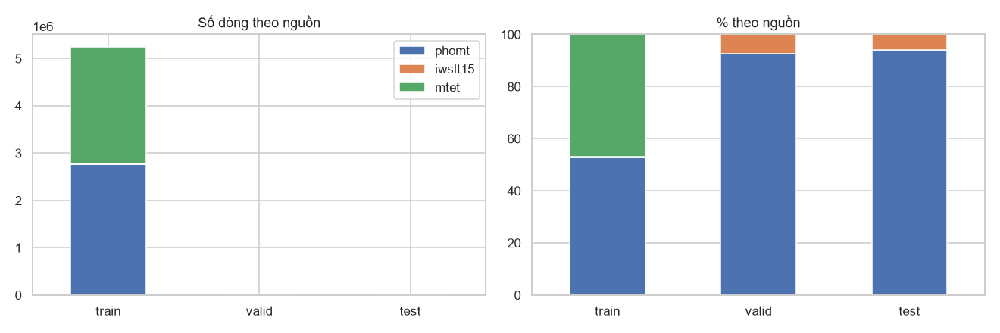
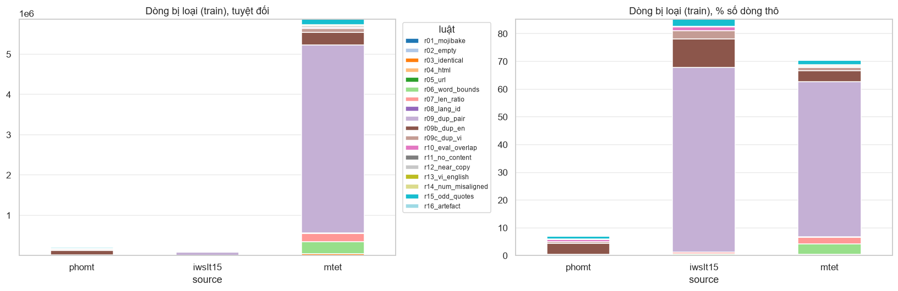
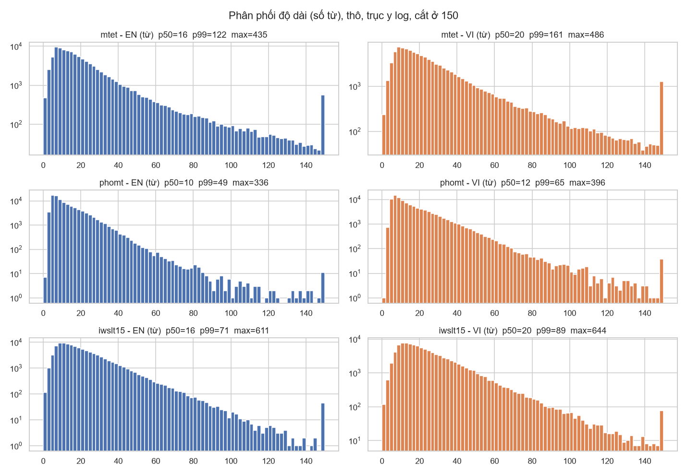
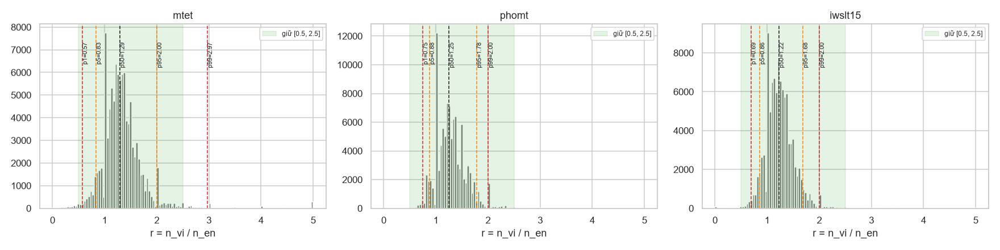
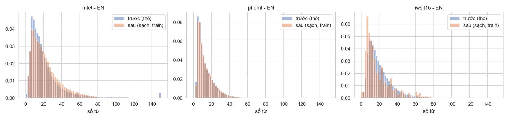
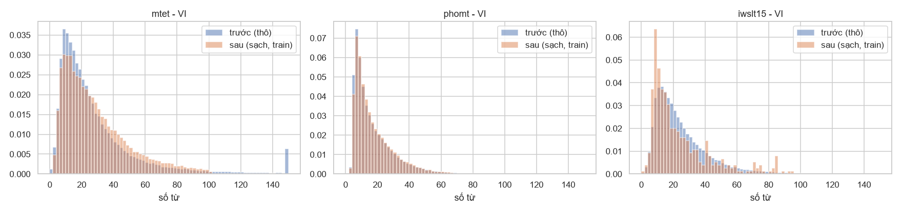
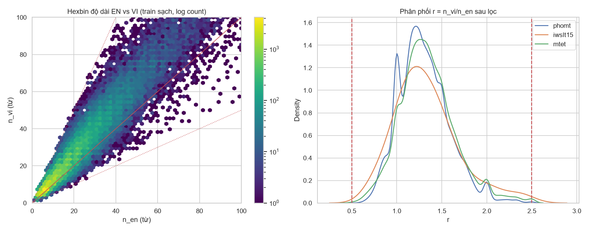
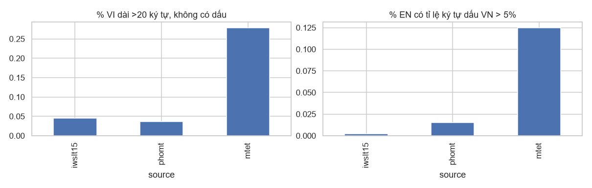
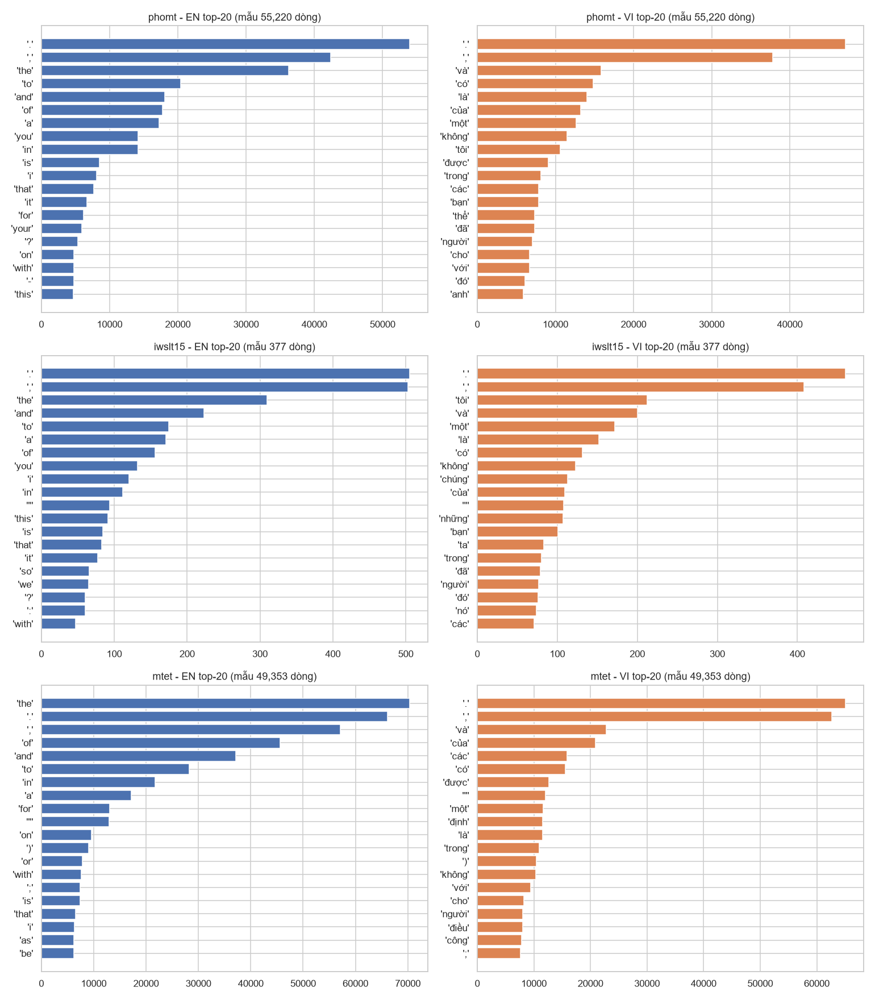

# 01. Chuẩn bị dữ liệu dịch máy EN–VI (`data_prep/data_prep.ipynb`)

> Số liệu lấy từ `data_prep/data/clean/stats.json`, `data_prep/data/clean/audit_before.json` và output của notebook ở trạng thái cuối (pipeline **v2**: đã thêm luật mojibake, dedup theo phía, chốt chặn mất mát và audit trước/sau; `SAMPLE=False`, thời gian pipeline 19.7 phút). Báo cáo này thay thế bản viết cho pipeline v1; mọi con số "v1" bên dưới là mốc so sánh (train v1 = 5,964,727 dòng, đo trong `audit_before.json`).

## 1. Mục tiêu và bối cảnh

**Mục tiêu**: gộp 3 nguồn song ngữ Anh–Việt về một định dạng chung, làm sạch bằng các luật *giải thích được và đếm được*, rồi xuất `train/valid/test` (`.en`, `.vi`, `.parquet`) vào `data_prep/data/clean/`. Kết quả cuối: **train 5,247,518 / valid 20,191 / test 20,259** cặp.

**Bối cảnh cho người mới với NMT**: mô hình dịch máy học từ các cặp câu `(en, vi)`. Dữ liệu bẩn (câu bị tokenize sẵn, lỗi mã hoá, sai hướng dịch, trùng lặp, lệch căn chỉnh, rò rỉ giữa train và test) làm mô hình học sai hoặc làm điểm đánh giá bị thổi phồng. Notebook này là bước "vệ sinh" trước khi huấn luyện tokenizer (xem `02_tokenizer.md`) và mô hình.

**Vì sao có v2**: audit độc lập trên train v1 (mục 6.8) cho thấy v1 còn mojibake (14,412 dòng EN), 2,647 dòng chứa `U+FFFD`, 18,210 cặp mà hai phía không có số nào chung, 96,134 dòng có nháy kép lẻ, và hơn 460 nghìn dòng có khoá EN trùng với dòng khác. v2 thêm các luật để xử lý từng lỗi đó, và đo lại bằng audit.

| Nguồn | Định dạng thô | Đặc điểm |
|---|---|---|
| **MTet** | 14 shard parquet (`prompt`, `response`, `translation{source,target}`) | Hướng dịch **trộn** EN→VI và VI→EN, phải suy ra từ `prompt`; đã tokenize (`I 'm`, `night .`); có mojibake (`“`) |
| **PhoMT** | CSV `en,vi` | Tokenize nhẹ (khoảng trắng quanh ` - `, `,`); valid có 1 ô rỗng và BOM đầu file |
| **IWSLT'15** | text song song `train`, `tst2012`, `tst2013` | Tokenize nặng + HTML entity (`'`, `"`); `tst2012` là valid, `tst2013` là test |

Số dòng thô: MTet train 8,327,706 (valid 3,106, test 2,536); PhoMT train 2,977,999 (valid 18,720, test 19,151); IWSLT'15 train 133,317 (valid 1,553, test 1,268). Tổng train thô 11,439,022.

## 2. Flow làm việc

```
 raw (không sửa)                        data/interim                       data/clean
 ┌────────────┐
 │ MTet 14 shd│─┐  [r01] sửa/loại mojibake ─► [1] detokenize + NFC ─► [r02..r08, r11..r16] lọc
 │ PhoMT csv  │─┼─►        (theo chunk/shard, 3 băm h_pair, k_en, k_vi)            │
 │ IWSLT txt  │─┘                                                                  ▼
 └────────────┘                                                    parquet trung gian (3 băm)
  valid/test làm TRƯỚC (ngưỡng lỏng, luật chỉ-train chỉ ĐẾM) ─► dedup nội bộ ─► test \ valid (r10_valid_overlap)
                                                                                   │ (băm valid/test)
                                                                                   ▼
        [r09] dedup cặp ─► [r10] loại train ∩ (valid ∪ test) theo cặp/EN/VI ─► [r09b] dedup khoá EN ─► [r09c] dedup khoá VI
                                                                                   ▼
                                           CHỐT CHẶN MẤT MÁT (GUARD) ─► xáo trộn 32 bucket (seed 42) ─► ghi .en/.vi/.parquet
                                                                                   ▼
                                                 assert bất biến ─► audit trước/sau (7b) ─► stats.json
```

Các bước trong notebook: (0) cấu hình, (1) nạp thô, (2) EDA thô, (3) detokenizer dùng chung, (4) luật lọc (kèm luật mới và đo độ chính xác), (5) chạy pipeline, (6) tổng kết trực quan và bằng chứng luật mới, (7) audit bất biến, (7b) audit độc lập trước/sau, (8) tóm tắt.

## 3. Môi trường và cách chạy lại

- Python venv: `D:\00_Workspace\AI_Lab\Neural_Machine_Translation\.venv` (notebook in ra: pandas 3.1.0, pyarrow 26.0.1, numpy 2.5.4).
- `requirements.txt`: nhóm data (`pandas, pyarrow, numpy, tqdm, requests`), viz (`matplotlib, seaborn`), tokenizers (`nltk, pyvi, sentencepiece, tokenizers, huggingface_hub`), notebook (`ipykernel, nbformat, nbconvert`).
- Chạy lại: mở `data_prep/data_prep.ipynb` bằng kernel của `.venv`, chạy tuần tự. `data/raw/` coi là không đáng tin và không bao giờ bị sửa; mọi thứ sinh ra nằm trong `data/interim`, `data/clean`, `data/figs`.
- **Cờ `SAMPLE`**: `True` chạy thử nhanh; `False` chạy toàn bộ (kết quả trong báo cáo này). `stats.json` ghi `sample_mode: false`.
- **Cảnh báo**: notebook này **xoá `data/interim/*`** khi chạy; các file tạm của notebook tokenizer (ví dụ `spm_train_*.txt`) nằm ở đó nên sẽ mất (xem `02_tokenizer.md`, mục "Lưu ý chạy lại").
- **`GUARD_OVERRIDE`**: chốt chặn mất mát (mục 5.6) dừng notebook nếu vượt ngưỡng; chỉ chạy tiếp khi đặt `GUARD_OVERRIDE=True` có chủ đích. Bản cuối đã đặt cờ này (xem 6.7).
- Hằng số chính (`stats.json`): `SEED=42`, `N_SHUF=32`, `PHOMT_POOL_FRAC=0.17`, `URL_FRAC=0.3`, `EN_DIAC_MIN_COUNT=3`, `EN_DIAC_MAX_FRAC=0.01` (v1: 0.05), `NEAR_COPY_MIN_CHARS=20`, `NEAR_COPY_RATIO=0.8`, `VI_EN_STOP_MIN=3`, `BASELINE_TRAIN_ROWS=5,964,727` (train v1), `MIN_TRAIN_ROWS=4,500,000`, `MAX_RULE_SHARE=0.03`.

## 4. Giải nghĩa khái niệm và công thức

| Khái niệm | Công thức / định nghĩa | Ý nghĩa một dòng |
|---|---|---|
| **NFC** | $s' = \mathrm{NFC}(s)$ | Dạng Unicode tổ hợp chuẩn: `a`+dấu sắc rời (U+0061 U+0301) thành `á` (U+00E1); không có bước này thì cùng một chữ Việt có nhiều mã khác nhau, dedup và tokenizer coi là khác nhau |
| **Mojibake** | $\hat s=\mathrm{decode}_{\text{utf-8}}^{\text{strict}}\big(\mathrm{bytes}_{\text{cp1252/latin-1}}(s)\big)$, chấp nhận khi $M(\hat s)=\emptyset\wedge\lvert M(\hat s)\rvert<\lvert M(s)\rvert$ | Văn bản UTF-8 bị đọc nhầm như cp1252 (`“I'm` thành `“I'm`); mã hoá ngược rồi giải mã lại đúng thì khôi phục được |
| **Detokenization** | $\text{detok}(\text{detok}(x))=\text{detok}(x)$ | Phục hồi văn bản tự nhiên từ văn bản đã tách; phải **luỹ đẳng**, notebook kiểm bằng `assert` |
| **Tỉ lệ độ dài** | $r=\dfrac{n_{vi}}{\max(n_{en},1)}$ | Cặp đúng thường có $r\approx1.1\text{–}1.4$; $r$ quá nhỏ/lớn là lệch căn chỉnh hoặc bản dịch cụt |
| **Ngưỡng theo percentile** | $p_q=\inf\{x:F_r(x)\ge q/100\}$ | Chọn $[r_{lo},r_{hi}]$ nằm ngoài $[p_5,p_{95}]$ nhưng gần $[p_1,p_{99}]$ để chỉ cắt phần đuôi |
| **Khoá dedup cặp** | $k=h(s_{en}\Vert\texttt{0x1F}\Vert s_{vi})$, 64-bit | So khớp chính xác cặp đã chuẩn hoá bằng băm; xác suất va chạm xấp xỉ $n^2/2^{65}$, với $n\approx10^7$ cỡ $3\times10^{-6}$ |
| **Khoá chuẩn hoá theo phía** | $k(s)=\mathrm{rm}_{\neg\mathrm{alnum}}\big(\mathrm{casefold}(s)\big)$ | Bỏ mọi ký tự không phải chữ/số (regex `\W` và `_`) ở mọi vị trí trong chuỗi, không chỉ ở hai đầu. Hai câu chỉ khác hoa/thường, dấu câu, khoảng trắng có cùng khoá; dùng cho `r09b`, `r09c`, `r10` |
| **Retention** | $\text{retention}=\dfrac{N_{after}}{N_{before}}$ | Tỉ lệ dòng giữ lại so với số dòng thô |
| **Language-ID theo dấu** | $n_{low}(s)=\lvert\{c\in s: c\in V,\ c\text{ thuộc từ bắt đầu bằng chữ thường}\}\rvert$; loại EN khi $n_{low}\ge3\wedge n_{low}/\lvert s\rvert>0.01$; VI: $[\lvert s\rvert>20\wedge\forall c: c\notin V]$ | $V$ là tập ký tự có dấu tiếng Việt. Chỉ đếm từ thường để không loại nhầm câu EN chứa tên riêng (`Nguyễn Thị Thủy`, `Hélène`) |
| **Near-copy** | $\mathrm{ratio}(a,b)=\dfrac{2M}{\lvert a\rvert+\lvert b\rvert}>0.8$ | $M$ là số ký tự khớp (difflib); EN gần giống VI nghĩa là chưa dịch |
| **Số rời nhau** | $N(en)\ne\emptyset\wedge N(vi)\ne\emptyset\wedge N(en)\cap N(vi)=\emptyset$ | $N(s)$ là tập số sau chuẩn hoá `1,000`/`1.000`/`1 000` thành `1000`; không con số nào khớp thì nghi lệch căn chỉnh |
| **Leakage check** | $\text{train}\cap(\text{valid}\cup\text{test})=\emptyset$, $\;\text{valid}\cap\text{test}=\emptyset$ (theo cặp, khoá EN **và** khoá VI) | Câu đã thấy khi train mà xuất hiện ở tập đánh giá làm điểm số ảo |
| **Chốt chặn mất mát** | dừng nếu $N_{train}<\texttt{MIN\_TRAIN\_ROWS}$ hoặc $\dfrac{\text{drop}_{rule}}{N_{v1}}>\texttt{MAX\_RULE\_SHARE}$ | Ngăn một luật mới nuốt quá nhiều dữ liệu mà không ai quyết định có chủ đích |
| **Hướng dịch MTet** | `to_en = TO_EN_RX.search(prompt[:60])`; nếu `to_en` thì `en = target`, ngược lại `en = source` | MTet trộn hai hướng, nên cột `en`/`vi` phải suy ra từ `prompt` |
| **Từ điển gạch nối** | $\rho_L(w)=\dfrac{\#\{w\text{ ngay trước gạch nối}\}}{\#w}$, $\rho_R(w)=\dfrac{\#\{w\text{ ngay sau gạch nối}\}}{\#w}$ | Bằng chứng thống kê để phân biệt từ ghép (`well - behaved`) với dấu gạch ngang thật (`diuretics - they`) |

## 5. Từng bước: hàm chính và lý do thiết kế

### 5.1 Nạp dữ liệu
- `read_lines`: chỉ tách theo `\n` (không dùng `splitlines`, vì nó cũng tách ở U+2028, U+0085 làm lệch hàng).
- `load_iwslt`, `iter_phomt` (đọc theo chunk, ô rỗng thành NaN, `utf-8-sig` bỏ BOM), `iter_mtet` + `mtet_batch_to_df` (đọc `iter_batches`, không nạp cả shard).
- **Hướng dịch MTet**: mẫu `prompt` thực tế có 6 dạng; `TO_EN_RX = into English|English translation|sang tiếng Anh`. Trong mẫu EDA, tỉ lệ `to_en` là 49.9%. Luật `r08_lang_id` là lưới an toàn thứ hai nếu vẫn lẫn hướng.

### 5.2 EDA thô (chọn ngưỡng)
- `load_phomt_pool`: pool ngẫu nhiên 17% trên **toàn bộ** PhoMT train (506,260 dòng), dùng cho EDA và xây từ điển gạch nối.
- `load_eda_sample`: 100,000 dòng/nguồn; MTet chỉ lấy `MTET_TRAIN[::3]`, row group 0 và 30, nên mẫu MTet **không ngẫu nhiên đều** và percentile có thể lệch (chỉ dùng để chọn ngưỡng thô).
- `eda_features`: số từ, số ký tự, $r$, các đại lượng dấu tiếng Việt.

### 5.3 Mojibake `r01_mojibake` (chạy **trước** detokenize)
**Vì sao.** Một phần MTet/PhoMT bị đọc nhầm UTF-8 như cp1252/latin-1 (`“I'm` thành `“I'm`; `½` thành `½`; `é` thành `é`) hoặc đã mất hẳn thông tin (`U+FFFD`: `Bogot��`). Tokenizer sẽ học các chuỗi rác này như từ thật. Phải xử lý trước detokenize vì `normalize_text` xoá ký tự điều khiển C1 (`\x80-\x9f`), vốn là bằng chứng của lỗi.

**Định nghĩa.** Tập dấu hiệu $M$ = `MOJI_RX` (`U+FFFD`, `Ã|Â` + byte tiếp nối, `â€`, chữ cái dẫn UTF-8 + ký hiệu Latin-1, ký tự C1 trơ trọi). Với dòng có dấu hiệu: thử mã hoá lại cp1252/latin-1 rồi giải mã UTF-8 nghiêm ngặt, chấp nhận khi hết dấu hiệu. Nếu cả dòng không mã hoá lại được (có chữ Việt đúng chuẩn lẫn vào) thì chỉ sửa **từng đoạn**; mẫu `†"` (dấu `—`) được khôi phục riêng. Mọi ca khác bị **loại**, và dòng có `U+FFFD` luôn bị loại (thông tin đã mất).

**Dương tính giả.** Chữ Việt hợp lệ có thể trùng byte dẫn UTF-8 (`Ã`, `Â`, `à`, `ô`): `à…` / `mà…` không bị gắn cờ; `â` chỉ tính khi theo sau là `€ ‚ „ † ‡ ˆ ‰`. Trên mẫu 706,260 cặp, VI có chữ `Ã/Â` viết hoa ở 2,667 dòng nhưng 0 dòng trong đó bị gắn cờ mojibake; tổng VI bị gắn cờ 3 / 706,260.

**Kết quả (train, `stats.json`)**: **sửa 30,159 câu** (MTet EN 30,128; MTet VI 12; PhoMT EN 17; PhoMT VI 2) và **loại 9,843 dòng** (MTet 8,650; PhoMT 1,191; IWSLT 2). valid/test: 0 sửa, 0 loại.

### 5.4 Detokenizer dùng chung `detokenize(x, lang)`
Một hàm cho cả 3 nguồn, vì nếu không thì cùng một câu ở hai nguồn khác khoảng trắng sẽ không bao giờ khớp khi dedup. Thứ tự:
1. `normalize_text`: `html.unescape` lặp tới điểm bất động (xử lý cả `&amp;quot;`), NFC, bỏ ký tự vô hình/điều khiển (`_INVISIBLE_RX`: BOM, zero-width, soft hyphen), gộp khoảng trắng.
2. Bỏ khoảng trắng trước `, . ; : ? ! % ) ] }` và sau `( [ {` (`_PUNCT_BEFORE`, `_OPEN_AFTER`).
3. `_DIGIT_HYPHEN`: `1 - 9 - 2019` thành `1-9-2019`.
4. **Gạch nối giữa chữ** (`build_hyphen_lex`, `_hy_join`, `_join_hyphens`): gộp `w1 - w2` thành `w1-w2` nếu cặp xuất hiện ít nhất `HY_PAIR_MIN=3` lần, hoặc $\rho_L(w_1)\ge\tau$ hay $\rho_R(w_2)\ge\tau$ ($\tau$ = `HY_RATE`: EN 0.12, VI 0.25; từ phải có ít nhất `HY_MIN_TOK=15` lần). **Không bao giờ gộp** khi một bên là từ chức năng (`_STOP`: `and`, `they`, `và`...) hoặc là số (trừ cặp thường gặp như `10-year`). Lý do: dấu gạch ngang thật `diuretics - they stimulate` và từ ghép `well - behaved` **giống hệt nhau về dạng**, không luật hình thức nào tách được, nên dùng bằng chứng thống kê. Kích thước từ điển: EN 4,786 cặp / 437 từ trái / 670 từ phải; VI 1,480 cặp / 132 / 135. Trên 3,000 dòng ứng viên của pool PhoMT: đổi 2,073, giữ 927.
5. `_SLASH`: `24 / 7` thành `24/7`, trừ dòng có IPA (`_IPA_RX`).
6. Co rút `do n't`, `don 't`, `'s 're 've 'll 'd` (`_NT`, `_APOS`) cho **cả hai phía** (v2 mở rộng sang VI và sau dấu `)`: `Snake 's End`, `(GDT) 's`).
7. `_fix_quotes` **áp sau cùng** (để luỹ đẳng): số `"` chẵn thì cắt khoảng trắng bên trong cặp; số lẻ thì chỉ sửa đầu/cuối dòng và hai mẫu `says, " Why` (`_Q_OPEN_ODD`) và `design " .` (`_Q_CLOSE_ODD`, không đụng dấu inch `5"`).

### 5.5 Các luật lọc (`RULES`, mỗi luật là `rule_*(df, P, source)` trả mask giữ)
Phạm vi: `all` = loại ở cả train/valid/test; `train` = chỉ loại ở train, ở valid/test chỉ **đếm** (giữ nguyên để không làm méo tập đánh giá). Mỗi dòng bị tính cho **luật đầu tiên** loại nó.

| # | Tên log | Phạm vi | Ý nghĩa |
|---|---|---|---|
| 0 | `r01_mojibake` | all | sửa hoặc loại lỗi mã hoá (mục 5.3) |
| 1 | `detokenize` + NFC | all | biến đổi, không loại |
| 2 | `r02_empty` | all | rỗng ở một phía |
| 11 | `r11_no_content` | all | một phía có $<2$ chữ cái hoặc chỉ là số thứ tự/gạch đầu dòng (`2.`, `(a)`) |
| 3 | `r03_identical` | all | EN == VI (casefold), thường là chưa dịch |
| 4 | `r04_html` | all | còn thẻ `<...>` |
| 5 | `r05_url` | all | URL chiếm từ 30% ký tự trở lên |
| 6 | `r06_word_bounds` | all | số từ trong [min, max], số ký tự không vượt max |
| 7 | `r07_len_ratio` | all | $r\in[0.5,2.5]$ và tỉ lệ ký tự trong [0.5, 3.5] |
| 8 | `r08_lang_id` | all | VI dài hơn 20 ký tự, không dấu **và** có ít nhất 5 chữ cái ASCII; hoặc EN chứa tiếng Việt (công thức mục 4, **thắt chặt so với v1**) |
| 12 | `r12_near_copy` | all | EN $\approx$ VI (câu $>20$ ký tự) |
| 13 | `r13_vi_english` | all | VI không dấu nào mà có $\ge3$ từ chức năng tiếng Anh (`the and of is`...) |
| 14 | `r14_num_misaligned` | train | hai phía đều có số nhưng hai tập số rời nhau hoàn toàn |
| 15 | `r15_odd_quotes` | train | số dấu `"` lẻ ở một phía (không tính dấu inch `5"`) |
| 16 | `r16_artefact` | train | còn tàn dư ` 's`/` n't`/`w / w` mà detokenizer không sửa được |
| 9 | `r09_dup_pair` | train | trùng cặp toàn cục, ưu tiên PhoMT > IWSLT > MTet |
| 10 | `r10_eval_overlap` | train | cặp, khoá EN **hoặc khoá VI** trùng valid/test |
| 9b | `r09b_dup_en` | train | trùng khoá EN với một dòng đã giữ |
| 9c | `r09c_dup_vi` | train | trùng khoá VI với một dòng đã giữ |
| 10b | `r10_valid_overlap` | test | cặp, khoá EN hoặc khoá VI của **test** trùng valid, loại khỏi test |

Ngưỡng (`stats.json`): train `max_words=100`, `max_chars=600`, `min_words` MTet 2 / PhoMT 1 / IWSLT 1; valid/test dùng ngưỡng **lỏng** (`max_words=250`, `max_chars=1500`, $r\in[0.25,4.0]$, tỉ lệ ký tự [0.3, 5.0]). `RuleLog` ghi số dòng bị loại theo (nguồn, split, luật) và tối đa 3 ví dụ.

**Lý do, định nghĩa và mức đúng của từng luật mới.** Cột cuối là tỉ lệ ví dụ được người kiểm tra đánh giá bằng mắt là đúng, trên **30 ví dụ ngẫu nhiên** do notebook in ra (mục "Đo độ chính xác", đo từng luật độc lập trên mẫu 706,260 cặp đã sửa mojibake và detokenize). Đây là ước lượng thô, không có khoảng tin cậy.

| Luật | Vì sao | Định nghĩa | Số loại (train) | Mức đúng khi kiểm mắt (30 ví dụ) |
|---|---|---|---:|---|
| `r08` (siết) | Bản v1 (đếm mọi ký tự dấu, ngưỡng 5%) hoặc bản nguyên văn gắn cờ nhiều câu EN hợp lệ chứa tên riêng; câu Việt/Pháp/Tây Ban Nha thật có nhiều từ thường có dấu | $n_{low}\ge3\wedge n_{low}/\lvert s\rvert>0.01$; tên ngắn (`Nguyễn`, `Đà Nẵng`) luôn được giữ. Trên mẫu: luật nguyên văn gắn cờ 593 dòng, luật chọn loại 133, giữ lại 460 dòng tên riêng/địa danh | 14,606 | khoảng 28/30 là lỗi thật |
| `r11_no_content` | Dòng rỗng nội dung (`.`, `36`, `165.`, `Vỗ tay`) không dạy dịch | $<2$ chữ cái hoặc chỉ là số thứ tự/gạch đầu dòng | 9,369 | chưa đo riêng; ví dụ in trong notebook (số đếm `10, 9, 8...` được giữ ở r08 nhờ điều kiện ASCII, bị r11 gắn cờ ở một số ca) |
| `r12_near_copy` | Câu VI chỉ lặp lại câu EN (tiêu đề, trích dẫn tiếng Anh) không dạy mô hình dịch | casefold; (i) bỏ số/dấu câu/khoảng trắng rồi so bằng nhau, hoặc (ii) tập từ chung $\ge50\%$ rồi mới tính difflib $>0.8$ | 38,107 | khoảng 100% |
| `r13_vi_english` | VI thực chất là tiếng Anh không dấu | VI không dấu nào, có $\ge3$ từ chức năng tiếng Anh | 1 (PhoMT) | hiếm; trên mẫu 58 dòng |
| `r14_num_misaligned` | Số hai phía không khớp là dấu hiệu lệch căn chỉnh | $N(en)\cap N(vi)=\emptyset$ khi cả hai đều có số | 33,737 | chỉ khoảng **55%** là lệch thật; khoảng 45% là **đổi đơn vị hợp lệ** (`200 pounds` thành `100 kí`, `25 miles` thành `40 cây số`, `50 feet` thành `15m`). Đây là luật **loại thừa có chủ đích** (thận trọng) |
| `r15_odd_quotes` | Nháy kép lẻ nghĩa là trích dẫn bị cắt (tách câu giữa đoạn trích) hoặc lệch căn chỉnh | đếm `"` không đứng ngay sau chữ số; lẻ ở một phía thì loại | 167,996 | cả 30 ví dụ đều đúng là nháy không cân; nhưng luật này loại **2.816% train v1** (mục 6.7) |
| `r16_artefact` | Còn tàn dư tokenize mà detokenizer không sửa được (`w / w`, nháy lồng nhau, IPA) | còn ` 's`/` n't`/`w / w` | 666 | chưa đo riêng |
| `r09b` / `r09c` | Cùng một câu EN có nhiều bản dịch khác nhau làm mô hình học phân phối nhập nhằng; tương tự cho khoá VI | giữ **một** dòng mỗi khoá EN, rồi mỗi khoá VI, ưu tiên PhoMT > IWSLT > MTet | 447,597 / 120,954 | khoảng 90% là bản trùng thật (khác nhau dấu câu, hoa/thường, hoặc cùng bản dịch); khoảng 10% là **bản dịch thay thế hợp lệ** bị loại |

Ghi chú về `r11`: dòng EN `10, nine, eight, ...` hay `20 percent.` / `20%.` bị gắn cờ trong các ví dụ của notebook (vì một phía chỉ gồm số); đây là ca biên cần biết, nhưng số lượng nhỏ (9,369 dòng, 0.157% train v1).

### 5.6 Pipeline, dedup theo phía và chốt chặn mất mát
- `build_eval(split)`: làm sạch valid/test với `EVAL_BOUNDS`, dedup nội bộ split; sau đó loại khỏi test mọi cặp, khoá EN và khoá VI đã có trong valid. **Không bao giờ lọc theo train.** Luật chỉ-train (`r14`, `r15`, `r16`) chỉ đếm ở valid/test.
- `run_train_cleaning`, `clean_to_interim`: làm sạch theo chunk/shard, ghi parquet trung gian kèm 3 băm 64-bit: `h_pair`, `k_en`, `k_vi`.
- `global_train_filter`: chỉ nạp các cột băm (rất nhẹ) để áp lần lượt `r09` (cặp), `r10` (cặp/EN/VI trùng valid/test), `r09b` (khoá EN), `r09c` (khoá VI); rồi kiểm **chốt chặn mất mát**; rồi xáo trộn theo luồng: gán ngẫu nhiên mỗi dòng vào 1 trong 32 bucket, xáo từng bucket trong RAM, ghi nối tiếp. Cột `source` được giữ trong parquet.
- **Chốt chặn**: dừng *trước khi ghi đè* `data/clean/` nếu train còn $<4,500,000$ dòng hoặc một luật mới loại hơn 3% so với train v1.
- `write_split`: ghi đồng thời `.en`, `.vi`, `.parquet` (UTF-8, `\n`).

## 6. Kết quả

### 6.1 Số dòng theo nguồn và split

| split | phomt | iwslt15 | mtet | tổng |
|---|---:|---:|---:|---:|
| train | 2,766,424 | 19,768 | 2,461,326 | **5,247,518** |
| valid | 18,705 | 1,486 | 0 | **20,191** |
| test | 19,070 | 1,189 | 0 | **20,259** |



**Thấy gì**: train gồm 52.7% PhoMT, 46.9% MTet và 0.38% IWSLT (panel phải, % theo nguồn); valid/test gần như toàn PhoMT (khoảng 92–94%) cộng IWSLT (khoảng 6–7%), không có MTet. Panel trái cho thấy train lớn hơn valid/test hơn hai bậc nên hai cột kia gần như không thấy. MTet có 0 dòng ở valid/test vì toàn bộ là bản sao hai chiều của IWSLT (mục 7).

### 6.2 Số dòng bị loại theo luật (train, từ `dropped_per_rule`)

| luật | phomt | iwslt15 | mtet | tổng |
|---|---:|---:|---:|---:|
| r01_mojibake | 1,191 | 2 | 8,650 | 9,843 |
| r02_empty | 0 | 151 | 528 | 679 |
| r03_identical | 139 | 121 | 31,802 | 32,062 |
| r04_html | 26 | 0 | 0 | 26 |
| r05_url | 271 | 2 | 4 | 277 |
| r06_word_bounds | 4,834 | 506 | 305,896 | 311,236 |
| r07_len_ratio | 5,253 | 996 | 203,099 | 209,348 |
| r08_lang_id | 1,003 | 10 | 13,593 | 14,606 |
| r09_dup_pair | 825 | 88,681 | 4,664,749 | 4,754,255 |
| r10_eval_overlap | 20,840 | 1,783 | 18,122 | 40,745 |
| r11_no_content | 227 | 34 | 9,108 | 9,369 |
| r12_near_copy | 2,616 | 36 | 35,455 | 38,107 |
| r13_vi_english | 1 | 0 | 0 | 1 |
| r14_num_misaligned | 5,104 | 311 | 28,322 | 33,737 |
| r15_odd_quotes | 31,127 | 3,279 | 133,590 | 167,996 |
| r16_artefact | 612 | 0 | 54 | 666 |
| r09b_dup_en | 119,428 | 13,704 | 314,465 | 447,597 |
| r09c_dup_vi | 18,078 | 3,933 | 98,943 | 120,954 |

(Tổng = 6,191,504 = 11,439,022 − 5,247,518.) Cột "tổng" tính từ bảng `dropped_per_rule` của `stats.json`.



**Thấy gì**: panel trái (tuyệt đối) bị MTet áp đảo, và phần lớn cột MTet là màu tím nhạt của `r09_dup_pair` (4.66 triệu dòng); trên đó là `r09b`/`r09c` (nâu), `r06`/`r07` (xanh lá, hồng) và `r15` (xanh ngọc). Panel phải (% dòng thô) cho thấy IWSLT mất khoảng 85%, MTet khoảng 70% và PhoMT khoảng 7%; riêng PhoMT, phần lớn mất mát là `r09b` (nâu). **Vì sao**: MTet có cả hai hướng dịch và nhiều nguồn chồng lặp; IWSLT mất 88,681 dòng ở `r09` (có thể do trùng nội bộ và/hoặc trùng PhoMT vì ưu tiên PhoMT > IWSLT > MTet; notebook không tách hai nguyên nhân). PhoMT giữ 92.895% (mục 6.3); phần mất chủ yếu do `r09b`, `r09c` và `r15` (bảng 6.2). Không có retention theo nguồn của v1 để so sánh (`audit_before.json` chỉ có số dòng toàn train).

### 6.3 Retention

| split | nguồn | dòng thô | giữ lại | retention % |
|---|---|---:|---:|---:|
| train | phomt | 2,977,999 | 2,766,424 | 92.895 |
| train | iwslt15 | 133,317 | 19,768 | 14.828 |
| train | mtet | 8,327,706 | 2,461,326 | 29.556 |
| train | ALL | 11,439,022 | 5,247,518 | 45.874 |
| valid | phomt / iwslt15 / mtet | 18,720 / 1,553 / 3,106 | 18,705 / 1,486 / 0 | 99.920 / 95.686 / 0.0 |
| valid | ALL / ALL_excl_mtet_eval | 23,379 / 20,273 | 20,191 | 86.364 / 99.596 |
| test | phomt / iwslt15 / mtet | 19,151 / 1,268 / 2,536 | 19,070 / 1,189 / 0 | 99.577 / 93.770 / 0.0 |
| test | ALL / ALL_excl_mtet_eval | 22,955 / 20,419 | 20,259 | 88.255 / 99.216 |

**Chú thích retention**: MTet valid/test có retention 0.00% **không phải lỗi**: 3,106 = 2 × 1,553 và 2,536 = 2 × 1,268, tức MTet valid/test chính là IWSLT tst2012/tst2013 lặp ở hai hướng dịch, nên bị dedup nội bộ split theo ưu tiên IWSLT. Vì vậy có thêm dòng `ALL_excl_mtet_eval`. Test còn bị loại thêm 131 dòng trùng valid (mục 6.5).

### 6.4 Độ dài trước/sau và tỉ lệ $r$



**Thấy gì**: histogram độ dài thô (trục y log, cắt ở 150) có đuôi dài: p99 MTet EN 122 / VI 161, max tới 435 / 486 từ; PhoMT p99 49 / 65; IWSLT p99 71 / 89. Cột cao ở 150 là phần bị cắt (gộp mọi câu dài hơn).



Percentile của $r$ trên mẫu thô (bảng của notebook, không đổi so với v1 vì mẫu EDA là dữ liệu thô):

| nguồn | p1 | p5 | p50 | p95 | p99 | % trong [0.5,2.5] (từ) | % trong [0.5,3.5] (ký tự) |
|---|---:|---:|---:|---:|---:|---:|---:|
| mtet | 0.571 | 0.833 | 1.288 | 2.000 | 2.97 | 97.902 | 98.395 |
| phomt | 0.750 | 0.875 | 1.250 | 1.778 | 2.00 | 99.913 | 99.938 |
| iwslt15 | 0.688 | 0.857 | 1.222 | 1.684 | 2.00 | 99.724 | 99.492 |

**Thấy gì**: thân phân phối tập trung quanh $r\approx1.2\text{–}1.3$, vùng giữ [0.5, 2.5] (xanh) chỉ cắt hai đuôi; MTet có đuôi phải dài nhất (p99 = 2.97, và cột nhỏ ở $r=5$ là phần bị gộp), nên MTet mất nhiều ở `r07_len_ratio`. **Lưu ý**: các cột nhọn ở $r=1.0$ và $r=2.0$ có thể do $r$ là tỉ số của hai số nguyên nhỏ ở câu ngắn (suy đoán, không kiểm chứng riêng).





Hai hình so mật độ độ dài (số từ) của mẫu thô với train sạch cho từng nguồn. **Thấy gì**: thân phân phối của PhoMT và MTet gần như trùng nhau; cột cao ở 150 của MTet "trước" (câu quá dài) biến mất ở "sau"; ở IWSLT mẫu "sau" nhỏ (mẫu 377 dòng) nên histogram lởm chởm, không nên đọc chi tiết. Số từ trung bình sau làm sạch (`mean_words`, từ `stats.json`): train phomt EN 13.32 / VI 17.21; train mtet 21.68 / 28.41; train iwslt15 18.72 / 24.36.



**Thấy gì**: dữ liệu sạch nằm gọn giữa hai đường chấm $r=0.5$ và $r=2.5$ quanh đường chéo; KDE của ba nguồn đều có đỉnh ở $r\approx1.2\text{–}1.3$ và tắt dần trước 2.5. PhoMT có thêm đỉnh nhọn ở $r=1$ và các đỉnh nhỏ ở $r\approx2$ (MTet cũng có đỉnh nhỏ ở 2; câu ngắn, tỉ số nguyên). Dùng mẫu 2% của train đã lọc (104,950 dòng).

### 6.5 Language-ID và leakage



Số liệu EDA trên dữ liệu **thô** (ngưỡng minh hoạ EN là 5%, không phải ngưỡng `r08` mới):

| nguồn | % VI dài hơn 20 ký tự, không dấu | % EN có $d_{en}>5\%$ | $d_{en}$ trung bình |
|---|---:|---:|---:|
| iwslt15 | 0.045 | 0.002 | 0.0000 |
| phomt | 0.036 | 0.015 | 0.0001 |
| mtet | 0.279 | 0.125 | 0.0004 |

MTet nhiễu nhất về ngôn ngữ/hướng (cao hơn các nguồn khác một bậc), đúng với việc `r08_lang_id` loại 13,593 dòng MTet train (93% của 14,606).

**Rò rỉ valid → test (v2 kiểm theo cả khoá EN và khoá VI)**: trước khi loại, test ∩ valid có 57 cặp trùng, 126 câu EN trùng và 66 câu VI trùng; **131 dòng** được loại khỏi test (`valid_test_overlap_removed_from_test`: pair 57, en_sentence 126, vi_sentence 66, removed 131; theo nguồn: iwslt15 70, phomt 61, mtet 0). Audit cuối: valid ∩ test = 0 cặp, 0 câu EN, 0 câu VI. Train ∩ (valid ∪ test) = ∅ theo cặp, khoá EN và khoá VI.

### 6.6 Hiệu quả detokenizer (artefact trước/sau, mẫu EDA)

`pct_artefact_*` dùng `ARTEFACT_RX` (dấu câu, co rút, entity, ` / `, nháy kép, gạch nối giữa chữ cái); `pct_spaced_hyphen_*` chỉ tính gạch nối.

| nguồn / phía | % dòng đổi (full) | artefact trước | artefact sau | ` - ` giữa chữ trước | sau |
|---|---:|---:|---:|---:|---:|
| iwslt15 EN | 99.809 | 99.809 | 0.005 | 0.004 | 0.004 |
| iwslt15 VI | 94.685 | 94.683 | 0.008 | 0.924 | 0.890 |
| phomt EN | 12.564 | 8.682 | 0.029 | 5.901 | 2.654 |
| phomt VI | 1.717 | 1.135 | 0.019 | 1.063 | 0.817 |
| mtet EN | 17.001 | 13.577 | 0.026 | 0.020 | 0.020 |
| mtet VI | 17.302 | 13.000 | 0.038 | 0.0 | 0.0 |

**Thấy gì**: artefact gần như về 0 ở cả 6 (nguồn, phía); tỉ lệ ` - ` còn lại ở PhoMT EN giảm từ 5.901% xuống 2.654% (không về 0, xem hạn chế). Luỹ đẳng được kiểm bằng `assert` trên toàn bộ mẫu EDA.



Top-20 token (mẫu 2% train sạch: 55,220 dòng phomt, 377 iwslt15, 49,353 mtet) là từ chức năng và dấu câu bình thường (`the`, `of`, `và`, `của`...); không còn `'s`, `n't`, `&apos;` trong top. Dấu `-` vẫn xuất hiện trong top-20 EN của PhoMT, nhất quán với phần gạch nối còn sót; MTet có thêm `"`, `)` và `:`, hợp với văn bản pháp lý/liệt kê.

### 6.7 Chốt chặn mất mát và quyết định `GUARD_OVERRIDE`

Mỗi luật mới được so với train v1 (5,964,727 dòng, `BASELINE_TRAIN_ROWS`) với ngưỡng `MAX_RULE_SHARE = 3%`:

| luật | % so với train v1 |
|---|---:|
| r01_mojibake | 0.165 |
| r08_lang_id | 0.245 |
| r11_no_content | 0.157 |
| r12_near_copy | 0.639 |
| r13_vi_english | 0.000 |
| r14_num_misaligned | 0.566 |
| r15_odd_quotes | 2.816 |
| r16_artefact | 0.011 |
| **r09b_dup_en** | **7.504** |
| r09c_dup_vi | 2.028 |

`stats.json` ghi `loss_guard`: `enforced: true`, `passed: false`. Đúng như thiết kế, chốt chặn **không đạt**: `r09b_dup_en` loại 7.504% > 3%. `MIN_TRAIN_ROWS` thì đạt (5,247,518 > 4,500,000).

**Đây là một quyết định ghi đè có chủ đích của người xây dựng pipeline (`GUARD_OVERRIDE=True`), không phải kết quả "đạt" tự nhiên.** Lý do chấp nhận: bản trùng khoá EN làm mô hình học phân phối nhập nhằng và làm lệch đánh giá (trước đó 7.780% train v1 có khoá EN trùng, 6.261% có khoá VI trùng). **Cái giá**: khoảng 90% dòng bị loại bởi `r09b`/`r09c` là bản trùng thật, nhưng khoảng 10% là bản dịch thay thế hợp lệ cho cùng một câu nguồn. Ngoại suy thô cho `r09b`: 10% × 447,597 ≈ 45 nghìn dòng (khoảng 0.75% train v1) mất đi diversity dịch; đây là ước tính từ tỉ lệ kiểm bằng mắt, không đo trực tiếp. Giữ luật vì audit trước/sau (6.8) cho thấy khoá EN/VI trùng về 0, nhưng người dùng nên biết dữ liệu mất một phần cách dịch khác nhau.

Cũng cần biết: `r15_odd_quotes` (2.816%, dưới ngưỡng nên không kích hoạt chốt chặn) loại nhiều hơn mức lỗi thật: các ví dụ kiểm đều đúng là nháy không cân, nhưng "nháy không cân" chưa chắc là câu hỏng không dùng được; `r14` thận trọng quá mức (khoảng 45% là đổi đơn vị hợp lệ).

### 6.8 Audit trước/sau (độc lập, đọc lại chính file đã ghi)
Các cột "trước" đọc từ `data/clean/audit_before.json` (đo trên train v1 trước khi thêm luật mới); "sau" đo ngay trên file vừa ghi bằng regex viết riêng (không gọi lại hàm của luật lọc).

| chỉ số | train trước (v1) | train sau | valid trước → sau | test trước → sau |
|---|---:|---:|---:|---:|
| số dòng (trước = v1) | 5,964,727 | 5,247,518 | 20,203 → 20,191 | 20,308 → 20,259 |
| EN mojibake (`â€`, `é`, `°`, C1) | 14,412 | **0** | 0 → 0 | 0 → 0 |
| VI mojibake | 86 | **0** | 0 → 0 | 0 → 0 |
| dòng có `U+FFFD` | 2,647 | **0** | 0 → 0 | 0 → 0 |
| EN: $\ge3$ ký tự dấu VN trong từ thường, tỉ lệ $>0.01$ | 1,982 | **7** | 3 → 0 | 2 → 0 |
| (tham khảo) EN: có $\ge1$ ký tự dấu VN | 65,677 | 48,706 | 156 → 151 | 162 → 158 |
| số hai phía rời nhau hoàn toàn | 18,210 | **0** | 27 → 27 | 34 → 34 |
| số dấu `"` lẻ (trừ dấu inch) | 96,134 | **0** | 165 → 165 | 166 → 165 |
| $<2$ chữ cái hoặc chỉ là số thứ tự | 481 | **0** | 2 → 0 | 1 → 0 |
| EN ≈ VI (sao chép) | 20,135 | **0** | 7 → 0 | 13 → 0 |
| EN == VI (casefold) | 0 | 0 | 0 → 0 | 0 → 0 |
| VI không dấu, $\ge3$ từ chức năng tiếng Anh | 1 | **0** | 0 → 0 | 0 → 0 |
| khoá EN trùng | 464,050 | **0** | 119 → 119 | 53 → 51 |
| khoá VI trùng | 373,442 | **0** | 35 → 35 | 15 → 15 |
| tàn dư ` 's` / ` n't` rời | 4,531 | **0** | 19 → 2 | 18 → 2 |
| tàn dư `w / w` | 344 | **0** | 1 → 1 | 1 → 1 |
| (tham khảo) EN: gạch nối tách rời giữa chữ cái | 83,263 | 80,916 | 605 → 604 | 640 → 639 |

Kết luận audit (notebook in `AUDIT ĐẠT`): mọi chỉ số lỗi của train bằng 0, riêng "EN dấu VN trong từ thường" còn 7 dòng (<0.1% như mục tiêu đặt ra). Gạch nối tách rời còn 80,916 dòng = 1.54% train, giữ như **giới hạn đã biết** (mục 8).

**valid/test không bị lọc theo luật chỉ-train.** Để không làm méo tập đánh giá, valid/test chỉ bị lọc bởi các luật `all`; các dòng vi phạm `r14`/`r15`/`r16` được **giữ** và chỉ được báo cáo (`flagged_kept_eval`): hai bộ số khác nhau vì đo ở hai thời điểm. (a) **Audit trên file cuối (sau dedup)**: valid 27 số rời nhau / 165 nháy lẻ; test 34 / 165. (b) **Đếm theo nguồn trong lúc làm sạch (`flagged_kept_eval` trong `stats.json`, `r14`/`r15`/`r16`, trước dedup nội bộ/`r10b`)**: PhoMT valid 24/134/3, test 26/141/3; MTet valid 6/62/0, test 16/52/0; IWSLT valid 3/31/0, test 8/26/0. Tổng (b) theo `r14`: valid 33, test 50; theo `r15`: valid 227, test 219, lớn hơn (a); chênh lệch này là suy luận, chưa tách riêng: (b) còn gồm các dòng MTet (bản sao IWSLT) về sau bị dedup và dòng test bị loại do trùng valid. Khoá EN/VI trùng ở valid (119/35) và test (51/15) cũng được giữ. Hệ quả: điểm đánh giá có thể bị ảnh hưởng nhẹ bởi vài trăm dòng nhiễu trong mỗi tập (khoảng 0.8% mỗi tập do nháy lẻ).

### 6.9 Audit bất biến
`assert` trên file xuất ra: không dòng rỗng; mọi dòng NFC; số dòng `.en` = `.vi` = `.parquet`; không cặp trùng trong từng split; không khoá EN/VI trùng trong train; train ∩ (valid ∪ test) = rỗng (cặp, khoá EN, khoá VI); valid ∩ test = rỗng. Số dòng audit: train 5,247,518 (audit train mất 377s), valid 20,191, test 20,259. Audit dùng `hash()` của Python thay vì hash pandas để đối chứng độc lập.

## 7. Phát hiện từ review và đã sửa gì

| Vấn đề phát hiện | Đã sửa |
|---|---|
| **Mojibake và `U+FFFD`** còn trong train v1 (14,412 + 86 dòng; 2,647 dòng `U+FFFD`) | Luật `r01_mojibake` trước detokenize: sửa 30,159 câu, loại 9,843 dòng |
| **Lỗi ngôn ngữ, sao chép, số lệch, nháy lẻ, thiếu nội dung** | Thêm `r08` (siết), `r11`, `r12`, `r13`, `r14`, `r15`, `r16` |
| **Trùng khoá EN/VI** (7.78% và 6.26% train v1) và rò rỉ theo khoá chuẩn hoá | `r09b`, `r09c`; `r10` kiểm theo cặp/EN/VI; test \ valid theo cả 3 loại |
| **Luật mới có thể nuốt quá nhiều dữ liệu** | Chốt chặn mất mát; `r09b` vượt 3% và được ghi đè có chủ đích (6.7) |
| **Không đo được hiệu quả sau khi sửa** | Mục 7b audit trước/sau với `audit_before.json` |
| **Artefact gạch nối và nháy kép** (`well - behaved`, `" abc "`) | Luật gạch nối dựa từ điển thống kê, `_SLASH`, `_fix_quotes` chẵn/lẻ (áp sau cùng) |
| **valid ∩ test** (57 cặp; 126 câu EN, 66 câu VI) | Loại 131 dòng khỏi test; audit assert rỗng |
| **Train không xáo trộn** | Xáo trộn theo 32 bucket (seed cố định), `train_shuffled: true` |
| **Retention MTet valid/test = 0.00% gây hiểu nhầm** | Thêm chú thích và dòng `ALL_excl_mtet_eval` |
| **Hướng dịch MTet bỏ sót `sang tiếng Anh`** | Bổ sung vào `TO_EN_RX` |
| **`r08_lang_id` có thể loại nhầm dãy số / tên riêng** | Điều kiện $\ge5$ chữ cái ASCII cho VI; EN chỉ đếm từ thường, $n_{low}\ge3$, tỉ lệ $>0.01$ |
| **`splitlines()` làm lệch hàng** | Dùng `split('\n')` trong `read_lines` |

Phát hiện quan trọng: **toàn bộ MTet validation/test (cả hai hướng) trùng chính xác IWSLT tst2012/tst2013**; valid/test thực chất = IWSLT + PhoMT.

## 8. Hạn chế còn lại

- **Hyphen recall**: vẫn còn **80,916 dòng** trong `train.en` (1.54% train; v1 là 83,263 dòng, audit đếm bằng regex viết riêng) chứa ` - ` giữa hai chữ cái, gồm cả dấu gạch ngang thật lẫn từ ghép chưa nhận ra. Ngược lại có thể gộp nhầm một số ít dấu gạch ngang thật. Giữ như giới hạn đã biết.
- **Nháy kép lẻ**: `_fix_quotes` chỉ sửa theo các mẫu đã nêu; có ca xử lý sai trong ví dụ của notebook (MTet EN `...tried this yet, " said jaffe ... " but i gotta` thành `yet, "said jaffe ... "but i gotta`, nháy đóng dính vào từ sau). Các dòng nháy lẻ còn lại đã bị `r15` loại ở train, nhưng valid/test vẫn giữ (165 dòng mỗi tập).
- **`r14` loại thừa** (khoảng 45% là đổi đơn vị hợp lệ) và **`r09b`/`r09c` loại khoảng 10% bản dịch thay thế hợp lệ**: tổn thất có chủ đích để đổi lấy dữ liệu sạch hơn (6.7). Độ chính xác của các luật mới chỉ đo bằng mắt trên 30 ví dụ mỗi luật, không có kiểm định chặt.
- **Không có mô hình căn chỉnh ngữ nghĩa** (ví dụ LaBSE) để lọc cặp lệch nghĩa: cần thêm phụ thuộc mới, chưa dùng; các luật hiện tại chỉ dựa dấu hiệu bề mặt (độ dài, số, nháy, dấu tiếng Việt).
- **valid/test giữ các dòng bị gắn cờ** (số rời nhau, nháy lẻ, khoá trùng) để không làm méo đánh giá, nên chúng không sạch bằng train.
- **MTet valid/test = bản sao IWSLT** nên MTet không đóng góp gì cho đánh giá; domain của valid/test hẹp (TED + PhoMT), trong khi train chứa nhiều văn bản pháp lý/hành chính từ MTet.
- EDA MTet chỉ từ vài row group nên percentile có thể lệch.
- Hash 64-bit có xác suất va chạm rất nhỏ nhưng khác 0.
- `r08_lang_id` chỉ dựa dấu tiếng Việt; không bắt được câu EN bị thay bằng ngôn ngữ khác không dấu (`r13` chỉ bắt VI tiếng Anh không dấu).
- Giấy phép: **PhoMT là CC-BY-NC-ND (phi thương mại)** (theo README của bộ dữ liệu, `cc-by-nc-nd-4.0`: https://huggingface.co/datasets/ura-hcmut/PhoMT); cần cân nhắc khi dùng/phát hành mô hình hoặc dữ liệu dẫn xuất.

## 9. Kết luận và bước tiếp theo

- Ba nguồn đi qua **cùng một** pipeline v2; kết quả: train **5,247,518** cặp (retention 45.874% so với 11,439,022 dòng thô; giảm 717,209 dòng so với train v1), valid **20,191**, test **20,259**, đã xáo trộn, không rò rỉ (cặp, EN, VI), đã qua audit (mọi chỉ số lỗi của train = 0, riêng EN dấu VN còn 7 dòng).
- Cần nói rõ khi báo cáo: (1) chốt chặn mất mát đã bị ghi đè có chủ đích cho `r09b` (7.504% > 3%); (2) khoảng 10% dòng bị dedup là bản dịch thay thế hợp lệ; (3) valid/test chỉ gồm IWSLT + PhoMT và giữ các dòng bị gắn cờ.
- Khuyến nghị: dùng `data/clean/*` làm đầu vào tokenizer/mô hình (xem `02_tokenizer.md`).
- Bước tiếp theo: (1) cải thiện recall gạch nối (ví dụ bổ sung từ điển từ nguồn có chú thích), (2) nới `r14` cho cặp đổi đơn vị hoặc đánh giá lại ngưỡng `r09b`, (3) cân nhắc mô hình căn chỉnh ngữ nghĩa (LaBSE) nếu chấp nhận thêm phụ thuộc, (4) cân nhắc dựng test riêng cho miền pháp lý/văn bản của MTet, (5) huấn luyện mô hình dịch và đánh giá bằng BLEU/chrF.
