# 02. So sánh 3 họ tokenizer cho EN–VI (`data_prep/tokenizer.ipynb`)

> Số liệu lấy từ `data_prep/results/*.csv`, `data_prep/tokenizers/train_times.json` và output notebook ở trạng thái cuối, chạy **lại trên dữ liệu v2** (`data/clean`: train 5,247,518 / valid 20,191 / test 20,259; xem `01_data_prep.md`). Mọi con số của báo cáo cũ (viết cho dữ liệu v1) đã bị thay. Cấu hình lưu trong notebook: `SAMPLE=False`, CPU = 20, tổng thời gian ghi trong output 13.6 phút, chạy liền một lượt với `REUSE=False` (xem mục 3 về cờ `REUSE`). Tập đánh giá chính là **valid** (20,191 cặp câu); test dùng kiểm tra chéo.

## 1. Mục tiêu và bối cảnh

**Câu hỏi**: với dữ liệu EN–VI đã làm sạch (`data/clean`, 5,247,518 cặp), tokenizer nào cho:
1. chuỗi token **ngắn** (attention tốn $O(L^2)$, decode tốn $O(L)$ bước),
2. **ít OOV** (không mất thông tin),
3. **nhanh**,
4. **khả đảo** (`decode(encode(x)) = x`)?

**Bối cảnh cho người mới**: mô hình không đọc chữ mà đọc **id của token**. Tokenizer quyết định "đơn vị" là gì: cả từ (từ vựng khổng lồ, nhiều từ lạ), ký tự/byte (không bao giờ lạ nhưng chuỗi rất dài), hay mảnh con từ (subword, thoả hiệp giữa hai thái cực). Notebook so sánh 3 họ, mỗi họ huấn luyện **riêng cho từng ngôn ngữ**, cùng một mẫu train.

| Họ | Triển khai | Variant trong bảng |
|---|---|---|
| Word-level | EN: `nltk.word_tokenize`; VI: `pyvi.ViTokenizer` (từ ghép nối `_`); top-$V$ từ, còn lại thành `<unk>`; **giữ nguyên hoa/thường** | `word` |
| BPE | HuggingFace `tokenizers.ByteLevelBPETokenizer`, `min_frequency=2` | `bpe` |
| SentencePiece | `unigram` và `bpe`, `byte_fallback=True`, `character_coverage=1.0`; thêm `unigram` **không** byte_fallback để đối chứng OOV | `spm_unigram`, `spm_bpe`, `spm_unigram_nobf` |

Cấu hình chung: `VOCAB_SIZE=32,000`, special tokens `<pad>=0, <unk>=1, <bos>=2, <eos>=3` ở mọi tokenizer; mẫu train `N_TRAIN_SENT=1,000,000` câu/ngôn ngữ (chọn bằng `rng.choice`, seed 42, cùng chỉ số cho EN và VI).

## 2. Flow làm việc

```
 data/clean/{train,valid,test}.{en,vi}   (v2: 5,247,518 / 20,191 / 20,259)
        │  read_lines (split '\n')
        ▼
 mẫu 1M câu train (seed 42) ──┬─► đếm từ (tok_utils.count_chunk, Pool) ─► word-level (top 32k)
                              ├─► train_bpe (HF, 8k/16k/32k)            ─► bpe
                              ├─► train_spm (unigram|bpe|unigram_nobf)  ─► spm_*
                              └─► joint: EN+VI ghép (2M câu)            ─► spm_unigram_joint, bpe_joint
        ▼
 REG[(variant, lang)]: enc_batch / enc_loop / dec / pieces / vocab / tok_bytes   (giao diện thống nhất)
        ▼
 eval_split (valid, test): fertility, CPT, L, OOV ─► tốc độ (bench) ─► round trip ─► Zipf, overlap, sweep, joint
        ▼
 SUMMARY (assert hợp lệ) ─► summary.csv, heatmap, kết luận sinh tự động từ DataFrame
```

## 3. Môi trường và cách chạy lại

- Python: `.venv` của repo, thư viện (trong `requirements.txt`): `nltk, pyvi, sentencepiece, tokenizers, pandas, numpy, matplotlib, seaborn, tqdm`.
- `data_prep/tok_utils.py`: chứa `tok_one`, `tok_chunk`, `count_chunk` ở mức module vì `multiprocessing` kiểu `spawn` trên Windows không pickle được hàm định nghĩa trong notebook. EN backend ở lần chạy này: `nltk.word_tokenize (punkt_tab)` (nếu thiếu dữ liệu `punkt_tab` thì fallback sang `NLTKWordTokenizer`).
- **Cờ `SAMPLE`**: `True` chạy thử (vocab 8,000, 50k câu train, 2,000 câu eval) và ghi đầu ra vào thư mục con `sample` (`results/sample`, `tokenizers/sample`); `False` chạy đầy đủ.
- **Cờ `REUSE`**: `True` thì nạp lại model/bộ đếm từ có sẵn trên đĩa thay vì train lại. Bản notebook cuối đã lưu ghi `REUSE=False` và chạy trọn vẹn trong một lượt (13.6 phút); `train_times.json` (thời gian train mọi tokenizer, cả hai joint) khớp với output của lượt chạy đó, và không có `MemoryError` nào trong output (xem "Lưu ý chạy lại").
- Worker pool: `N_POOL = min(cpu, 12) = 12` tiến trình (mỗi worker nạp PyVi cỡ 190MB RAM theo comment trong notebook); SPM dùng `num_threads = min(16, cpu) = 16`.
- **Thời gian huấn luyện** (giây, `tokenizers/train_times.json`):

| tokenizer | EN | VI |
|---|---:|---:|
| word (đếm từ, Pool) | 17.5 | 26.9 |
| bpe 8k / 16k / 32k | 6.2 / 6.5 / 7.1 | 6.1 / 6.7 / 7.5 |
| spm_unigram | 105.2 | 104.1 |
| spm_bpe | 10.1 | 9.7 |
| spm_unigram_nobf | 104.8 | 104.2 |
| **joint** (EN+VI ghép): spm_unigram / bpe | 202.6 / 9.7 | |

SPM unigram chậm hơn SPM BPE cỡ 10 lần (105.2/10.1 = 10.4 EN, 104.1/9.7 = 10.7 VI; ở mẫu 1M câu); BPE của HuggingFace (Rust) rất nhanh (6–8 giây). Thời gian là một lần đo, có nhiễu.

### Lưu ý chạy lại

- **RAM (phòng ngừa)**: cell huấn luyện joint-SPM ghép EN+VI thành 2M câu và có thể báo `MemoryError`. Lỗi này đã gặp ở lần chạy thử trước, trên máy 16GB; không còn trong output cuối. Nếu gặp lại: giải phóng bộ nhớ hoặc **restart kernel**, **xoá file joint cũ có thể dở dang** (`tokenizers/spm_unigram_joint.*`, `tokenizers/bpe_joint/`, `data/interim/spm_train_joint.txt`) trước khi chạy lại với `REUSE=True`, để các tokenizer đã train xong không bị train lại.
- **NLTK `punkt_tab`**: trong sandbox của Claude, `nltk.download('punkt_tab')` có thể lỗi quyền ghi vào thư mục dữ liệu; hãy chạy notebook trong terminal/VS Code của chính mình (hoặc cài sẵn `punkt_tab`). Nếu thiếu, `tok_utils` fallback sang `NLTKWordTokenizer`, nhưng khi đó số liệu word-level EN có thể khác nhẹ.
- **`data_prep.ipynb` xoá `data/interim/`**: các file tạm của notebook này (ví dụ `spm_train_{lang}.txt`) sẽ mất nếu `data_prep.ipynb` chạy lại sau đó; với `REUSE=True` file này được tạo lại nếu thiếu. Nếu dữ liệu `data/clean` đổi thì **phải** chạy với `REUSE=False` (không nạp tokenizer cũ), vì tokenizer cũ được train trên dữ liệu cũ.

## 4. Giải nghĩa khái niệm và công thức

### 4.1 Ba thuật toán
| Thuật toán | Cách học | Ghi chú |
|---|---|---|
| **Word-level** | Cắt thành từ, giữ top-$(V-4)$ từ + 4 special; từ ngoài vocab thành `<unk>`. VI cần PyVi vì khoảng trắng tách *âm tiết*, không tách *từ* ("sinh viên" = 2 âm tiết) | Chuỗi ngắn nhưng OOV cao, vocab và embedding lớn |
| **BPE** | Bắt đầu từ ký tự/byte, lặp lại gộp cặp liền kề phổ biến nhất tới khi đủ $V$ | Quyết định gộp theo tần suất, tất định |
| **Unigram LM (SentencePiece)** | Bắt đầu từ vocab lớn, tỉa dần mục từ làm giảm likelihood ít nhất | Cho phép nhiều cách tách cùng một câu (có xác suất); SentencePiece coi khoảng trắng là `▁` nên không cần tiền tách từ |
| **Byte-level** | Bảng chữ cái gốc là đủ 256 byte (`ByteLevel.alphabet()`) | Mọi chuỗi mã hoá được, nên không có `<unk>`; đổi lại chữ Việt có dấu là 2–3 byte và ký tự hiếm có thể bị tách thành mảnh byte |
| **`byte_fallback`** (SPM) | Ký tự chưa thấy thành chuỗi byte `<0xNN>` thay vì `<unk>` | `spm_unigram_nobf` dùng để đo đúng số OOV mà `byte_fallback` cứu |
| **`character_coverage=1.0`** | Không bỏ ký tự hiếm khỏi bảng chữ cái | Hợp lý với bộ chữ nhỏ như EN/VI |
| **Joint vs separate vocab** | Joint: một vocab 32k học trên EN+VI ghép; separate: hai vocab 32k, mỗi ngôn ngữ một | Joint cho phép tie embedding/đa ngôn ngữ; separate có tổng 64k mục |
| **NFKC** | Chuẩn hoá tương thích mặc định của SentencePiece (ví dụ `…` thành `...`) | Gây mất khả đảo nhỏ ở round trip |

### 4.2 Metric (trên tập $\mathcal D$)
$$F=\frac{\sum_{s}|t(s)|}{\sum_{s}w(s)},\qquad \text{CPT}=\frac{\sum_{s}c(s)}{\sum_{s}|t(s)|}$$
**Fertility** $F$ = số token trung bình trên một "từ tham chiếu" (càng gần 1 càng nén). EN: từ tách khoảng trắng; VI có hai cách: âm tiết (`fert_ws`) và từ PyVi (`fert_pyvi`). **CPT** (chars per token) cao nghĩa là chuỗi ngắn.

$$L=\frac{1}{|\mathcal D|}\sum_{s}|t(s)|,\qquad \%_{>k}=100\cdot\frac{|\{s:|t(s)|>k\}|}{|\mathcal D|},\ k\in\{64,128,256\},\qquad \rho=\frac{L_{vi}}{L_{en}}$$
**Mean length** $L$ = độ dài chuỗi token trung bình; $\%_{>k}$ cho biết bao nhiêu câu bị cắt nếu đặt `max_len=k`; $\rho$ lệch khỏi 1 nghĩa là nguồn và đích khác độ dài nhiều.

$$\text{OOV}_{tok}=\frac{\#\texttt{<unk>}}{\sum_s|t(s)|},\quad \text{OOV}_{type}=\frac{|\{w\in\mathcal W(\mathcal D): w\text{ không biểu diễn được}\}|}{|\mathcal W(\mathcal D)|},\quad \text{OOV}_{sent}=\frac{|\{s:\texttt{<unk>}\in t(s)\}|}{|\mathcal D|}$$
**OOV token / type / sentence**: tỉ lệ token là `<unk>`; tỉ lệ *loại từ* (type) không biểu diễn được; tỉ lệ câu có ít nhất một `<unk>`.

$$f(r)\propto r^{-\alpha}\quad(\text{Zipf})$$
**Zipf**: tần suất của đơn vị thứ $r$ giảm theo luỹ thừa của hạng; trên log-log là đường gần thẳng, đuôi dài nghĩa là nhiều embedding chỉ thấy vài lần.

$$\text{sent/s}=\frac{|\mathcal D|}{\tilde t},\qquad \text{tok/s}=\frac{\sum_s|t(s)|}{\tilde t}$$
**Tốc độ**: $\tilde t$ là **trung vị** của 3 lần đo sau 1 lần warm-up. Hai chế độ: `loop` (từng câu trong vòng lặp Python, 1 luồng) và `batch` (đa luồng/đa tiến trình, mức song song khác nhau theo họ).

$$R=\frac{|\{s:\text{decode}(\text{encode}(s))=s\}|}{|\mathcal D_{rt}|}$$
**Round trip** $R$ trên 5,000 câu valid chọn ngẫu nhiên (seed); câu lệch được phân loại: `has_unk`, `spacing_only`, `other_normalization`.

$$J=\frac{|V_{en}\cap V_{vi}|}{|V_{en}\cup V_{vi}|}$$
**Jaccard** của hai vocab: đo mức chia sẻ mục từ giữa EN và VI (bỏ special tokens).

## 5. Từng bước: hàm chính và lý do

| Bước | Hàm | Lý do thiết kế |
|---|---|---|
| Nạp | `read_lines` | Đọc `.en/.vi` thẳng hàng (đúng định dạng SentencePiece), tách riêng theo `\n` |
| Lấy mẫu | `rng.choice` + kiểm tra `source` | Tái lập được dù train đã xáo; tỉ lệ nguồn mẫu bám toàn tập (phomt 52.66% vs 52.72%, mtet 46.96% vs 46.90%, iwslt15 0.38% vs 0.38%) |
| Word-level | `tokenize_words`, `count_words`, `build_word` | `Pool` + worker trong `tok_utils` (spawn Windows); mỗi worker trả `Counter` cho cả khối câu để tránh truyền list token khổng lồ giữa tiến trình |
| BPE | `train_bpe` (`bpe_dir`) | Huấn luyện cả 8k/16k/32k để vẽ sweep |
| SPM | `train_spm` | Cấu hình `SPM_CFG` cho 3 variant; ghi mẫu ra `data/interim/spm_train_{lang}.txt` vì SPM đọc từ file |
| Registry | `build_word`, `build_hf`, `build_spm`, `bl_decode`, `bytes_to_unicode` | Một giao diện (`enc_batch`, `enc_loop`, `dec`, `pieces`, `vocab`, `tok_bytes`) để một đoạn code đo metric cho cả 5 variant |
| Metric | `eval_split`, `type_oov` | Tính $F$, CPT, $L$, OOV; `type_oov` đếm type theo định nghĩa riêng cho từng họ |
| OOV | `word_oov_curve`, `oov_kind` | Đường cong OOV theo $N$ dùng rank tần suất train; phân loại từ OOV (số, Viết hoa, thường, khác) |
| Tốc độ | `bench` | Warm-up + trung vị 3 lượt |
| Round trip | `roundtrip` | Phân loại nguyên nhân lệch |
| Tổng hợp | `SUMMARY` + `assert` | 3 họ x 2 ngôn ngữ, không NaN, $R\in[0,1]$, BPE không có `<unk>`, `vocab_size == 32000` |
| Kết luận | ô code f-string | Mọi con số trong kết luận lấy từ DataFrame của lần chạy này, không gõ tay |

Mẫu train: 1,000,000 câu mỗi ngôn ngữ, bằng khoảng 19.1% của 5,247,518 cặp train. Đếm từ: EN 340,774 loại / 20,146,916 token; VI (qua PyVi) 308,717 loại / 20,196,510 token.

## 6. Kết quả

### 6.1 Bảng metric (valid, 3 họ x 2 ngôn ngữ; `results/summary.csv`)

| lang | variant | F (ws) | F (PyVi) | CPT | L mean | L p95 | L p99 | L max | %>64 | OOV tok % | OOV type % | OOV câu % |
|---|---|---:|---:|---:|---:|---:|---:|---:|---:|---:|---:|---:|
| en | word | 1.1804 | | 4.747 | 15.44 | 36 | 53.1 | 223 | 0.475 | 3.592 | 32.728 | 30.410 |
| en | bpe | 1.2855 | | 4.359 | 16.82 | 41 | 61.0 | 284 | 0.812 | 0 | 0 | 0 |
| en | spm_unigram | 1.3049 | | 4.294 | 17.07 | 41 | 61.0 | 281 | 0.842 | 0 | 0 | 0 |
| en | spm_bpe | 1.3101 | | 4.277 | 17.14 | 41 | 62.0 | 281 | 0.807 | 0 | 0 | 0 |
| en | spm_unigram_nobf | 1.3038 | | 4.298 | 17.06 | 41 | 61.0 | 281 | 0.832 | 0.011 | 0.022 | 0.015 |
| vi | word | 0.9223 | 1.0000 | 4.789 | 15.69 | 37 | 55.0 | 219 | 0.520 | 2.462 | 29.551 | 22.718 |
| vi | bpe | 1.1455 | 1.2420 | 3.856 | 19.48 | 49 | 74.0 | 315 | 1.719 | 0 | 0 | 0 |
| vi | spm_unigram | 1.1388 | 1.2348 | 3.878 | 19.37 | 49 | 73.0 | 312 | 1.664 | 0 | 0 | 0 |
| vi | spm_bpe | 1.1398 | 1.2358 | 3.875 | 19.39 | 49 | 73.0 | 308 | 1.669 | 0 | 0 | 0 |
| vi | spm_unigram_nobf | 1.1384 | 1.2344 | 3.879 | 19.37 | 49 | 73.0 | 312 | 1.664 | 0.006 | 0.065 | 0.020 |

Lưu ý khi đọc:
- OOV $=0$ của `bpe`, `spm_unigram`, `spm_bpe` là **hệ quả của cách xây dựng** (byte-level / `byte_fallback`), không phải phát hiện thực nghiệm. Chỉ `word` và `spm_unigram_nobf` có OOV đo được.
- `n_types` **không so sánh được giữa các họ** (word: type sau NLTK/PyVi, đã tách dấu câu và ghép âm tiết; subword: type của từ tách khoảng trắng), nên `oov_type` giữa họ chỉ tham khảo.
- Word-level EN có $F>1$ vì NLTK tách dấu câu và clitic (`don't` thành `do`, `n't`); VI có $F_{ws}<1$ vì PyVi *gộp* âm tiết thành từ ghép.
- Tỉ số $\rho=L_{vi}/L_{en}$: word 1.016; bpe 1.158; spm_unigram 1.135; spm_bpe 1.131; spm_unigram_nobf 1.135.

**Kiểm tra chéo trên test** (`summary_test.csv`, 20,259 cặp): xu hướng giống valid, ví dụ `spm_unigram` EN $F=1.3076$, $L=18.24$; VI $F=1.1374$, $L=20.75$; `word` OOV token EN 3.76%, VI 2.59%; `bpe` EN $F=1.2890$, VI $F=1.1439$.

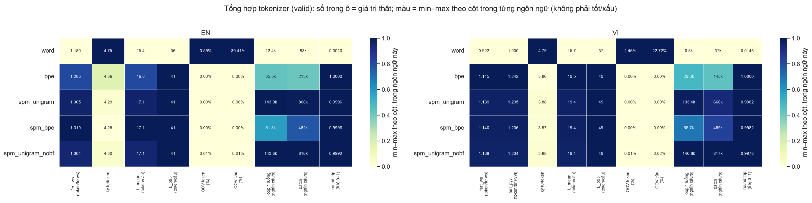

**Thấy gì**: số trong ô là giá trị thật, màu là min–max **theo cột trong từng ngôn ngữ** (không phải tốt/xấu). Hàng `word` nổi bật ở CPT cao và $L$ ngắn nhưng có OOV token 3.59% (EN) / 2.46% (VI), OOV câu 30.41% / 22.72% và round trip gần 0 (0.0010 / 0.0146); bốn biến thể subword (`bpe`, `spm_unigram`, `spm_bpe`, `spm_unigram_nobf`) gần như giống nhau về $F$, $L$, CPT. Ở cột tốc độ, `spm_unigram` và `spm_unigram_nobf` đậm nhất (nhanh nhất), `bpe` kém hơn SPM ở cả hai chế độ.

### 6.2 Fertility theo từng câu

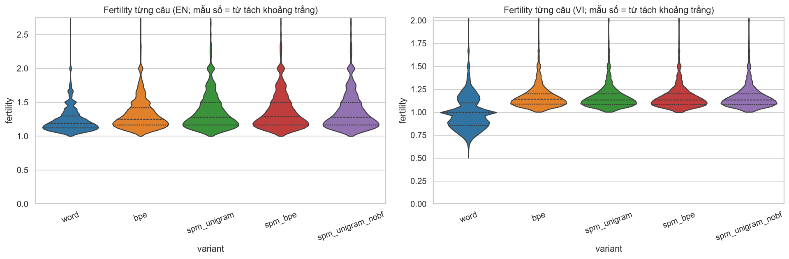

Trung bình fertility từng câu (mẫu số là từ tách khoảng trắng): EN word 1.238, bpe 1.330, spm_unigram 1.365; VI word 0.986, bpe 1.174, spm_unigram 1.168; p99 EN subword 2.25–2.33 so với 1.83 của word. **Thấy gì**: violin EN subword rộng và có đuôi dài lên trên 2; VI subword hẹp quanh 1.1–1.2; VI word nằm dưới 1 (PyVi gộp âm tiết). **Ý nghĩa**: trung bình che mất đuôi, câu có tên riêng, số, từ hiếm bị tách nhiều mảnh; EN subword có phân phối rộng hơn VI (độ lệch chuẩn 0.24–0.28 so với 0.14–0.15).

### 6.3 Độ dài chuỗi

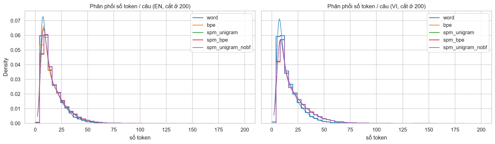

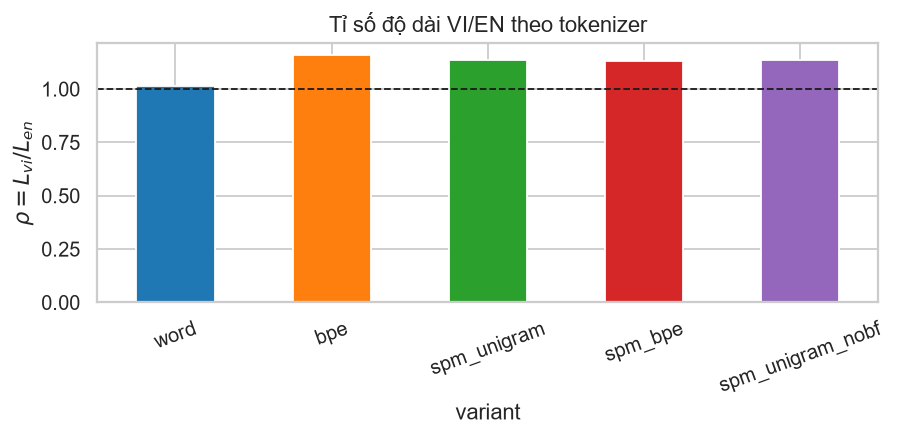

**Thấy gì**: các phân phối độ dài gần như chồng khít, đỉnh quanh 8–10 token với đuôi phải dài; `word` có đỉnh nhọn hơn một chút ở ít token. Subword dài hơn word-level (EN: 15.44 lên 16.82–17.14, khoảng +9–11%; VI: 15.69 lên 19.37–19.48, khoảng +24%) và VI dài hơn EN rõ rệt ở subword ($\rho\approx1.13\text{–}1.16$) trong khi word-level gần như cân ($\rho=1.016$). **Vì sao**: PyVi gộp âm tiết nên word-level VI ngắn; subword VI phải tách nhiều chữ có dấu (2–3 byte). Hệ quả thực tế: tỉ lệ câu VI vượt 64 token (1.66–1.72%) cao hơn EN (0.81–0.84%) khoảng gấp đôi; vượt 256 token chỉ cỡ 0.005–0.01%.

### 6.4 OOV

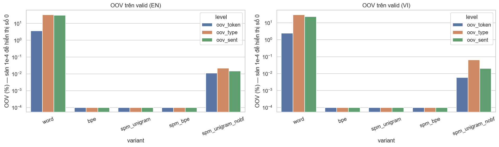

**Thấy gì**: trục log; chỉ `word` và `spm_unigram_nobf` có cột đo được (nobf nhỏ hơn word 2–3 bậc: OOV token 0.011% EN / 0.006% VI, so với 3.59% / 2.46%; `n_unk` 38 EN và 23 VI so với 11,202 và 7,798).

Đường cong OOV theo kích thước vocab (word-level, `word_oov_curve.csv`):

| N | EN OOV token % | EN OOV type % | VI OOV token % | VI OOV type % |
|---:|---:|---:|---:|---:|
| 8,000 | 9.85 | 70.23 | 6.56 | 63.18 |
| 16,000 | 6.10 | 50.88 | 3.90 | 43.77 |
| 32,000 | 3.59 | 32.73 | 2.46 | 29.55 |
| 64,000 | 2.23 | 20.62 | 1.75 | 21.51 |
| 128,000 | 1.50 | 13.94 | 1.37 | 17.05 |
| toàn bộ vocab train (EN 340,778; VI 308,721) | 1.00 | 9.87 | 1.07 | 13.83 |

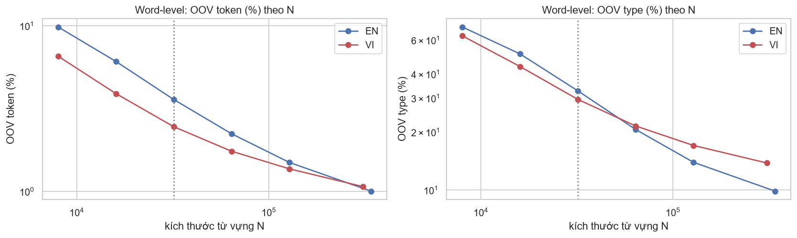

**Thấy gì**: log-log gần tuyến tính; mỗi lần nhân đôi $N$ giảm OOV token một phần nhỏ và đường cong mềm dần (VI ở cuối cong phẳng hơn EN); ngay cả giữ **toàn bộ** vocab train vẫn còn OOV token EN 1.00%, VI 1.07% (từ chưa từng thấy). Đường nét đứt đánh dấu $N=32{,}000$. **Vì sao**: phân phối từ có đuôi rất dài (hapax chiếm 55.9% type EN và 61.5% type VI của mẫu train).

Từ OOV thuộc loại nào (valid, word-level): EN 11,202 token OOV (7,799 type): Viết hoa đầu 48.9%, chữ thường 39.5%, khác 6.2%, số 5.3%; VI 7,798 token (5,467 type): Viết hoa 70.7%, thường 24.4%, số 4.0%, khác 0.9%. Tức OOV chủ yếu là **tên riêng** (ví dụ `GoDaddy`, `Subašić`, `Bolt`), đúng loại mà copy mechanism hoặc subword xử lý được.

### 6.5 Zipf, độ dài mục từ, overlap, scatter

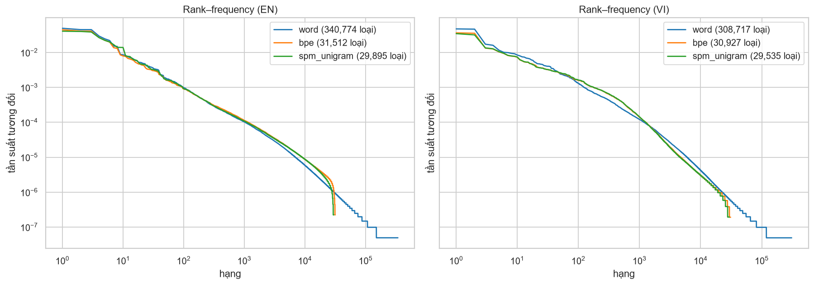

**Thấy gì**: word-level kéo đuôi tới hạng ~$10^5$ (340,774 loại EN, 308,717 loại VI; hai số này lấy từ output notebook) với tần suất tương đối chạm sàn ~$10^{-7}$, còn BPE/unigram dừng ở khoảng 30k loại (`bpe` 31,512 EN / 30,927 VI; `spm_unigram` 29,895 / 29,535 trong 200,000 câu đầu của mẫu) và có đuôi dốc xuống đột ngột ở cuối (đọc từ hình, chưa đối chiếu: các số 31,512 / 30,927 / 29,895 / 29,535 và mức ~$10^{-7}$ không có trong output hay CSV nào). **Vì sao**: subword có vocab cố định nên không có đuôi vô hạn các embedding hiếm.

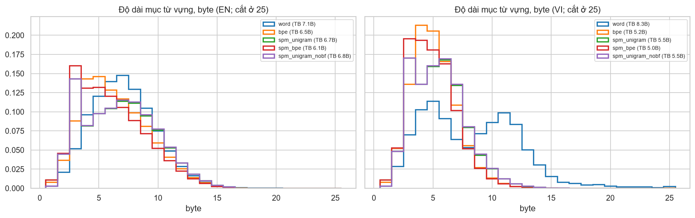

Histogram độ dài mục từ theo **byte UTF-8** (cắt ở 25) cho thấy tokenizer học ra đơn vị "to" hay "nhỏ"; dùng byte để so công bằng giữa HF byte-level, SPM và word-level.

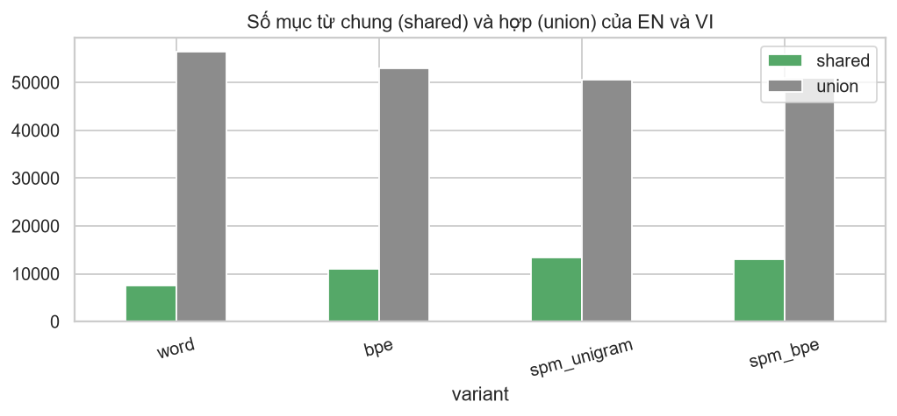

| variant | mục chung | hợp | Jaccard | % vocab EN |
|---|---:|---:|---:|---:|
| word | 7,487 | 56,505 | 0.133 | 23.4 |
| bpe | 11,059 | 52,933 | 0.209 | 34.6 |
| spm_unigram | 13,366 | 50,626 | 0.264 | 41.8 |
| spm_bpe | 12,968 | 51,024 | 0.254 | 40.5 |

**Thấy gì**: cột xanh (chung) nhỏ hơn nhiều cột xám (hợp) ở cả 4 variant. Mức chia sẻ vocab EN/VI thấp đến trung bình (Jaccard 0.13–0.26); mục chung chủ yếu là dấu câu, số, tên riêng (15 mục BPE chung dài nhất chủ yếu là chuỗi dấu chấm/gạch/`…`, kèm `Pharmaceuticals`, `Communications`, `Constantinople`, `corticosteroid`). Vocab word/subword đếm 31,996 mục không special mỗi ngôn ngữ (32,000 trừ 4 special).

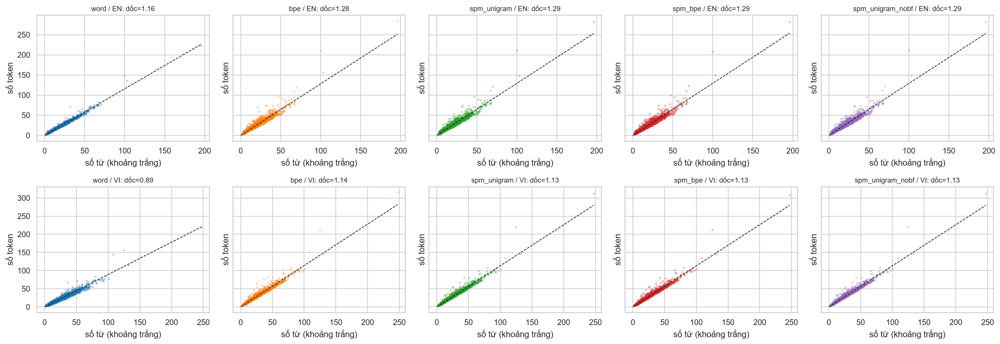

Scatter 5,000 câu (token theo số từ) với đường hồi quy qua gốc cho thấy fertility trung bình là độ dốc và độ dốc có đồng đều theo độ dài câu hay chỉ do ngoại lai (độ dốc ghi ở tiêu đề từng panel).

### 6.6 Quét kích thước vocab BPE (`bpe_vocab_sweep.csv`)

| lang | V | F (ws) | CPT |
|---|---:|---:|---:|
| en | 8,000 | 1.4778 | 3.791 |
| en | 16,000 | 1.3601 | 4.120 |
| en | 32,000 | 1.2855 | 4.359 |
| vi | 8,000 | 1.1938 | 3.700 |
| vi | 16,000 | 1.1630 | 3.797 |
| vi | 32,000 | 1.1455 | 3.856 |

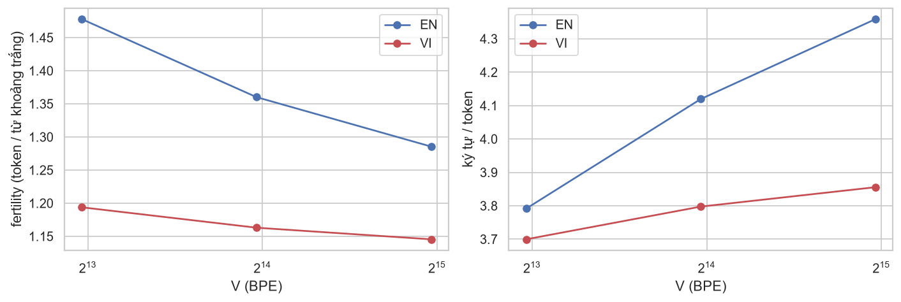

**Thấy gì**: fertility giảm dần khi tăng $V$, lợi ích biên giảm: nhân đôi 16k lên 32k giảm 5.5% (EN) nhưng chỉ 1.5% (VI). **Vì sao**: VI đã gần tối đa nén ở mức âm tiết (mỗi âm tiết thường là 1 token), EN còn nhiều từ dài để gộp. Chi phí embedding/softmax tăng tuyến tính theo $V$.

### 6.7 Joint vs separate (`joint_vs_separate.csv`, V=32,000)

| algo | lang | $F$ separate | $F$ joint | thay đổi | $L$ separate | $L$ joint |
|---|---|---:|---:|---:|---:|---:|
| bpe | en | 1.2855 | 1.3064 | +1.63% | 16.82 | 17.09 |
| bpe | vi | 1.1455 | 1.1599 | +1.27% | 19.48 | 19.73 |
| spm_unigram | en | 1.3049 | 1.3266 | +1.66% | 17.07 | 17.36 |
| spm_unigram | vi | 1.1388 | 1.1525 | +1.21% | 19.37 | 19.61 |

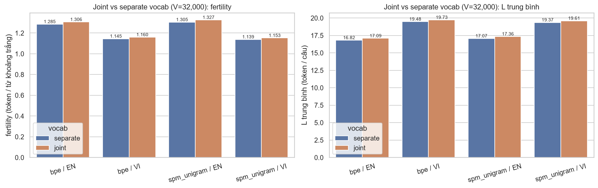

**Thấy gì**: vocab chung 32k làm fertility tăng nhẹ 1.2–1.7% so với hai vocab riêng (cột cam cao hơn cột xanh ở cả 4 cặp), chuỗi dài thêm khoảng 0.23–0.28 token/câu; `n_unk=0` ở mọi cấu hình. **Lưu ý ngân sách**: joint có 32k mục cho cả hai ngôn ngữ, separate có 32k mỗi ngôn ngữ (tổng 64k), nên đây là so sánh "cùng $V$ cho mỗi bộ tokenizer", không cùng số tham số embedding. Chỉ đo fertility/độ dài, **không** đo chất lượng dịch (joint vocab chỉ được đánh giá bằng fertility).

### 6.8 Tốc độ (`speed.csv`; CPU=20, SPM threads=16, word Pool=12; 20,191 câu valid)

Câu/giây (trung vị 3 lượt):

| variant | EN loop | EN batch | VI loop | VI batch |
|---|---:|---:|---:|---:|
| word | 12,375 | 83,283 | 6,784 | 37,321 |
| bpe | 35,452 | 213,452 | 29,828 | 144,792 |
| spm_unigram | 143,866 | 800,309 | 133,390 | 659,832 |
| spm_bpe | 51,305 | 481,881 | 55,700 | 488,703 |
| spm_unigram_nobf | 143,585 | 809,879 | 140,767 | 817,330 |

**Công bằng giữa `loop` và `batch`**: `loop` chạy 1 luồng/1 tiến trình cho cả ba họ nên là so sánh công bằng; `batch` bị lệch vì mức song song khác nhau (HF `encode_batch` Rust đa luồng, SPM 16 luồng, word-level Pool 12 tiến trình). Tỉ số **loop** so với word-level, EN / VI: `bpe` 2.86 / 4.40; `spm_unigram` 11.63 / 19.66; `spm_bpe` 4.15 / 8.21. Tỉ số **batch** so với word: `bpe` 2.56 / 3.88; `spm_unigram` 9.61 / 17.68; `spm_bpe` 5.79 / 13.09 (chỉ tham khảo). Pool của word-level tăng tốc batch/loop 6.73x (EN) và 5.50x (VI).

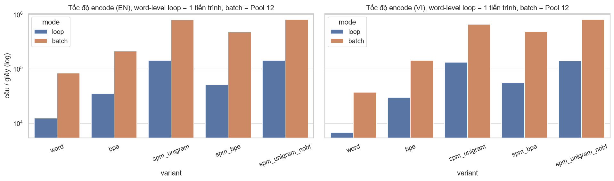

**Thấy gì**: trục log; mọi subword nhanh hơn word-level ở cả hai chế độ và hai ngôn ngữ; `spm_unigram` (và biến thể nobf) nhanh nhất; batch luôn nhanh hơn loop. **Cảnh báo nhiễu giữa các lần chạy**: số đo là trung vị 3 lượt trong **một** lần chạy, trên máy dùng chung. Dấu hiệu: `spm_bpe` loop chậm hơn `spm_unigram` loop 2–3 lần dù cùng bộ mã hoá SentencePiece; `spm_unigram_nobf` và `spm_unigram` cùng cấu trúc nhưng loop VI lệch 5.5% (141k so với 133k) và batch VI lệch 24% (817k so với 660k), trong khi EN gần như bằng nhau (loop 143.6k so với 143.9k), tức chênh lệch nhỏ không ổn định giữa các cấu hình. Chỉ nên đọc **thứ bậc lớn** (`spm_unigram` vượt word-level hơn một bậc độ lớn ở loop, SPM unigram nhanh nhất), không đọc chênh lệch nhỏ giữa các subword; các số tuyệt đối cũng sẽ thay đổi mỗi lần chạy.

### 6.9 Round trip (`roundtrip.csv`, 5,000 câu valid)

| variant | EN $R$ | VI $R$ | ghi chú |
|---|---:|---:|---|
| word | 0.0010 | 0.0146 | EN: 1,557 có `<unk>`, 3,333 chỉ khác khoảng trắng, 105 chuẩn hoá khác (`"` thành ` `` `); VI: 1,094 `<unk>`, 3,833 khoảng trắng |
| bpe | 1.0000 | 1.0000 | khả đảo hoàn toàn (byte-level) |
| spm_unigram | 0.9996 | 0.9982 | EN 2 câu, VI 9 câu lệch do NFKC (`…` thành `...`, `º` thành `o`) |
| spm_bpe | 0.9996 | 0.9982 | như trên |
| spm_unigram_nobf | 0.9992 | 0.9978 | như trên, thêm 2 câu có `<unk>` ở mỗi ngôn ngữ |

**Ý nghĩa**: word-level gần như không khả đảo nếu chỉ nối bằng dấu cách (không có detokenizer thông minh) và không bao giờ khôi phục được `<unk>`; SPM chỉ mất vài ký tự (`…`, `º`) do NFKC mặc định (tắt bằng `normalization_rule_name=identity` nếu cần khôi phục 100%); byte-level BPE khả đảo tuyệt đối.

### 6.10 Ví dụ phân đoạn

`results/segmentation_examples.csv` lưu 10 câu valid cố định (3 chọn theo tiêu chí, 7 ngẫu nhiên). Ví dụ câu #0 (có `Eclipse`, `Jakarta EE`, `runtimes`, `Geospatial`), số token EN: word 62; bpe 76; spm_unigram 76; spm_bpe 77 (VI: word 62; bpe 82; spm_unigram 79; spm_bpe 83). Tên riêng và từ kỹ thuật hiếm bị tách thành các mảnh (`Ec|lip|se`, `run|time|s`) ở subword, trong khi word-level giữ nguyên nhưng sẽ thành `<unk>` nếu ngoài top 32k.

## 7. Phát hiện từ review và đã sửa gì

| Vấn đề | Cách sửa trong notebook cuối |
|---|---|
| Nhầm lẫn "OOV = 0 là kết quả" | Thêm khung lưu ý: OOV $=0$ là hệ quả cấu trúc; thêm biến thể `spm_unigram_nobf` để đo OOV thật |
| `n_types` giữa các họ không so sánh được | Ghi rõ định nghĩa và cảnh báo ở bảng tổng hợp |
| So sánh tốc độ thiếu công bằng (mức song song khác nhau) | Báo cả `loop` (1 luồng, công bằng) và `batch`; thêm bảng tỉ số so với word và `PAR_NOTE` |
| Heatmap màu lẫn EN/VI, số không phải giá trị thật | Tách heatmap theo ngôn ngữ, min–max theo cột, nhãn ô là giá trị thật kèm đơn vị |
| Glyph hiển thị | Trạng thái cuối: token BPE hiển thị qua `bl_decode` (mảnh byte dở dang hiện `�`), `▁` và `_` được chú giải trong ví dụ phân đoạn |
| Kết luận gõ tay có thể lỗi thời | Ô kết luận dựng bằng f-string từ `SUMMARY`, `SPEED`, `curve`, `SWEEP`, `OVL`, `RTDF`, `JOINT` |
| Joint vs separate chỉ là giả thuyết dựa trên overlap | Thử trực tiếp bằng train joint SPM unigram + joint BPE (mục 12.7 của notebook) |
| Mẫu train có đại diện không? | Kiểm tra tỉ lệ nguồn mẫu so với toàn tập (mục 5) |
| Dữ liệu đổi (v1 sang v2) làm số liệu cũ lỗi thời | Chạy lại toàn bộ notebook trên `data/clean` v2; báo cáo này dùng toàn bộ số mới |

## 8. Hạn chế

- **Không đo chất lượng dịch** (BLEU/chrF); chọn theo fertility không chứng minh dịch tốt hơn.
- **Một seed duy nhất**, không có khoảng tin cậy.
- Tokenizer huấn luyện trên **mẫu 1,000,000 câu/ngôn ngữ** trong 5,247,518 cặp train (~19%); `Zipf` đếm trên 200,000 câu đầu của mẫu.
- **Joint vocab chỉ kiểm bằng fertility/độ dài**, một cấu hình ($V$ cố định, unigram và BPE); quét $V$ chỉ làm cho BPE.
- Tốc độ đo trên một máy, một lần chạy, **ồn** (xem 6.8); mức song song khác nhau theo họ nên chỉ `loop` là công bằng.
- Round trip chỉ trên 5,000 câu, không phải toàn bộ valid.
- Valid/test gồm IWSLT + PhoMT (xem `01_data_prep.md`), domain hẹp hơn train; valid/test cũng **giữ** một số dòng bị gắn cờ (nháy lẻ, số rời nhau), nên số đo có thể bị ảnh hưởng nhẹ. Ảnh hưởng tới số đo OOV (nhất là word-level) chưa được tách riêng.
- Dữ liệu huấn luyện có PhoMT (**CC-BY-NC-ND**, phi thương mại, theo README của bộ dữ liệu, `cc-by-nc-nd-4.0`: https://huggingface.co/datasets/ura-hcmut/PhoMT), nên tokenizer huấn luyện trên đó cũng cần cân nhắc điều khoản này.

## 9. Kết luận, khuyến nghị và bước tiếp theo

- **Độ dài vs OOV**: word-level cho chuỗi ngắn nhất ($L$ 15.44 EN / 15.69 VI) nhưng OOV token 3.59% / 2.46% và 30.4% / 22.7% câu có `<unk>`; subword dài hơn ~9–11% (EN) và ~24% (VI) so với word-level nhưng không có `<unk>` (do cấu trúc).
- **Bốn biến thể subword (`bpe`, `spm_unigram`, `spm_bpe`, `spm_unigram_nobf`) gần như tương đương** về $F$, $L$, CPT (EN $F$ 1.286–1.310, VI 1.138–1.146 theo âm tiết); chênh lệch nhỏ hơn nhiều so với khoảng cách tới word-level.
- **Khuyến nghị (theo metric tokenizer, không phải BLEU)**: dùng subword (SentencePiece unigram hoặc byte-level BPE) thay vì word-level: không cần PyVi, nhanh hơn rõ rệt, không mất thông tin vì `<unk>`. Nếu cần khôi phục văn bản gốc 100% thì dùng byte-level BPE hoặc SPM với `normalization_rule_name=identity`.
- **Joint vs separate** vẫn là giả thuyết cần kiểm bằng BLEU: overlap vocab thấp (Jaccard 0.21–0.26 với subword) và fertility joint kém hơn separate 1.2–1.7%; chỉ nên chọn joint khi cần tie embedding hoặc đa ngôn ngữ.
- **Kích thước vocab**: lợi ích biên giảm nhanh ở VI (16k lên 32k chỉ giảm 1.5%); cân nhắc 16k nếu cần embedding nhỏ.
- **Bước tiếp theo**: (1) huấn luyện mô hình dịch với 2–3 ứng viên (spm_unigram separate, spm_unigram joint, bpe) và so BLEU/chrF, nhiều seed; (2) đo lại tốc độ trên máy rảnh, lặp nhiều lần; (3) thử vocab 16k cho VI; (4) kiểm tra ảnh hưởng của tên riêng/số (nguồn OOV chính) lên chất lượng dịch.
